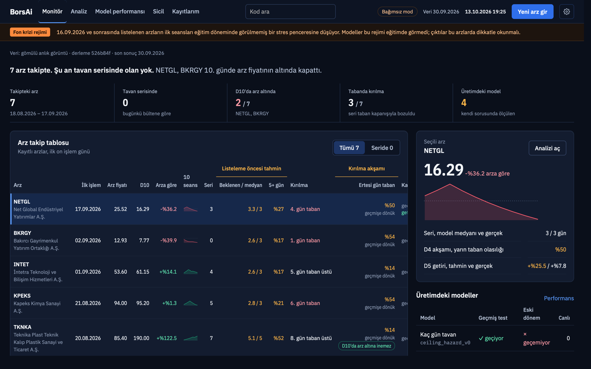
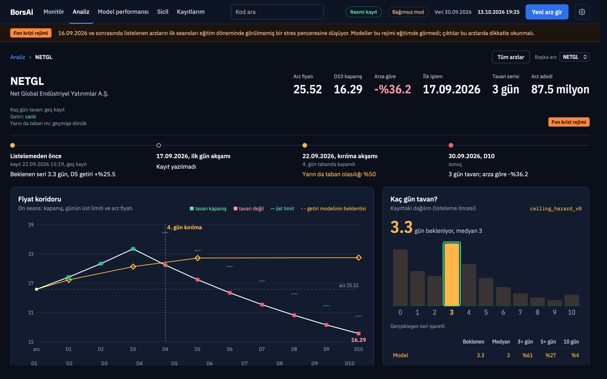
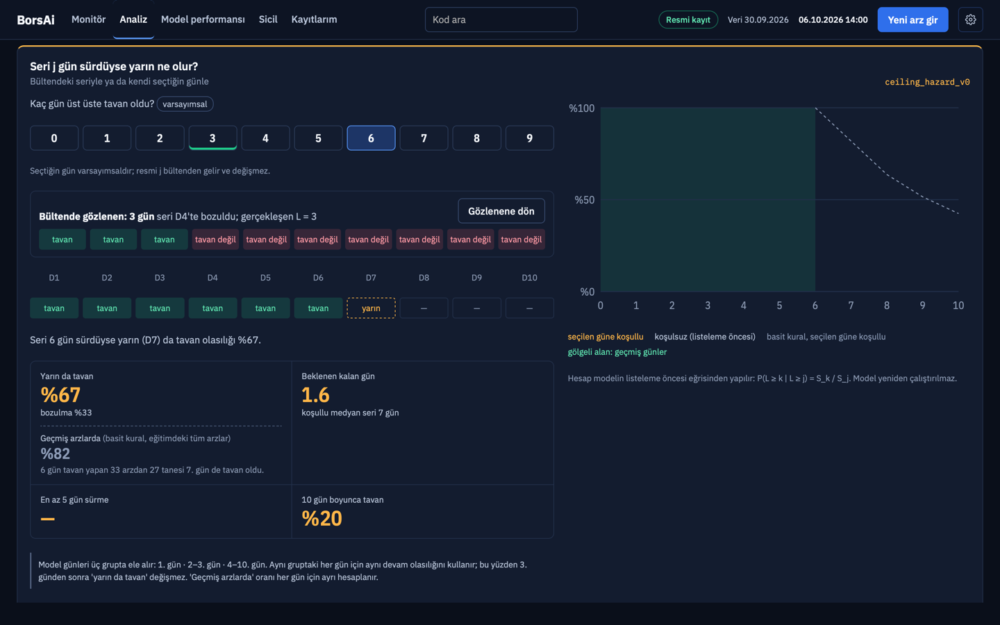
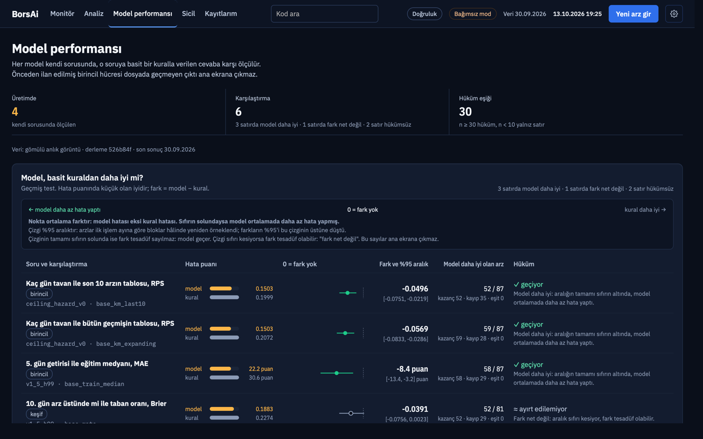

# BorsAi

Borsa İstanbul halka arzları için doğruluğu ölçülmüş tahmin modelleri ve onları gömülü çalıştıran bir masaüstü uygulaması.

**In English.** BorsAi forecasts how Borsa İstanbul IPOs trade in their first ten sessions: how many days the price closes at
the daily upper limit, the return on days 1–10, and the chance of a limit-down close after the streak breaks. Every model is
frozen before use and scored against simple rules on the same IPOs, on three scales that are never added together:
retrospective backtest, live prospective registry and an out-of-time cohort. The desktop app (macOS, Windows) runs the frozen
models offline. Today the backtest shows several models beating the simple rules; the live registry is too small for any
verdict, and the out-of-time results are mixed (see "Dürüst durum"). It produces probabilities and statistics, not
investment advice or buy/sell signals. This repository is a single-commit public mirror of a private source repository;
raw exchange bulletins and official documents are not redistributed (DATA_NOTICE.md).

| Monitör (kişisel mod, gömülü sicil) | Analiz: bir arzın on seansı |
|---|---|
|  |  |
| **Seri hesaplayıcı: "seri j gün sürdüyse yarın ne olur?"** | **Model performansı: model, basit kurala karşı** |
|  |  |

## Ne yapar

Bir halka arzın ilk on işlem gününü üç anda tahmin eder. Çıktılar olasılık ve dağılımdır; al-sat sinyali değildir.

1. **Listelemeden önce** (talep toplama sonrası, KAP ve SPK belgelerindeki girdilerle): kaç gün üst üste tavan kapatacağı
   (0–10 gün dağılımı), D1, D3, D5 ve D10 getirisi, kapanışın arz fiyatının üstünde olma olasılığı, D10'da arz fiyatının
   altına düşme olasılığı.
2. **Seri sürerken:** "seri j gün sürdüyse yarın da tavan mı?" Dondurulmuş kaydın dağılımından koşullu olasılık; model
   yeniden çalıştırılmaz. İlk gün tavan kapatan arz için D1 akşamı ayrı bir güncelleme modeli vardır.
3. **Kırılma akşamı:** seri bozulduğu gün, ertesi gün taban kapanış olasılığı.

Her model kullanılmadan önce dondurulur (parametre dosyası, sha256, push kanıtı) ve aynı arzlarda basit kurallarla (her zaman
tavan, eğitim medyanı, taban oranı, son 10 arzın oranı) eşleşik skorlanır. Bir çıktı uygulamanın ana ekranında ancak önceden
ilan edilmiş birincil hücresi "geçiyor" ise öne çıkar; değilse gri ve "≈" işaretiyle durur.

## Kurulum

Paketler [Releases](https://github.com/AhmetEmreOzumagi/borsai-app/releases) sayfasındadır. İkisi de imzasızdır (geliştirici
sertifikası yok).

- **macOS (Apple Silicon):** `BorsAi_<sürüm>_aarch64.dmg`'yi açın, BorsAi'yi Uygulamalar'a sürükleyin. İlk açılışta uygulamaya
  sağ tıklayın → **Aç** → **Aç**. macOS 15 ve sonrasında bu yetmezse: Sistem Ayarları → Gizlilik ve Güvenlik → **Yine de Aç**.
- **Windows (x64):** `BorsAi_<sürüm>_x64-setup.exe`'yi çalıştırın. SmartScreen uyarısında **Ek bilgi** → **Yine de çalıştır**.
  Kurulum yalnız sizin kullanıcınız içindir, yönetici izni istemez; dili Türkçe ya da İngilizce seçilebilir. WebView2
  Windows 10/11'de genelde vardır; yoksa kurulum bir kez internetten indirir.
- **Kişisel mod** (uygulamada "Bağımsız mod"; varsayılan): Python ya da git gerekmez, uygulama ağa çıkmaz; modeller uygulamanın
  içinde (Rust) hesaplanır. Yeni arz girişi, tahmin sonucu ve kayıtlarım çalışır. Monitör, Analiz, Sicil ve Model performansı
  paketin derlendiği andaki resmi sicilin gömülü, salt okunur kopyasından okunur; Monitör derlemeyi ve son sonuç tarihini
  yazar (v0.1.0: son sonuç 30.09.2026, 7 arz). Yeni arzlar ve sonuçlar yeni paketle gelir.
- Release paketleri özel kaynak reponun CI'ında derlenir (v0.1.0: özel repo `af234f9`; aşağıda "Kaynak ve kanıt");
  uygulamanın Ayarlar → Hakkında ekranı derleme commit'ini gösterir.

## Dürüst durum

Sayılar `scores/*.json`'dan; okunur hâlleri [`docs/SCORES.md`](docs/SCORES.md), [`docs/SCORES_OOT.md`](docs/SCORES_OOT.md),
[`docs/SCORES_BREAK.md`](docs/SCORES_BREAK.md). Fark = model − kural (küçük olan iyi); aralık %95, ay-blok bootstrap. "Geçiyor"
yalnız n ≥ 30 ve aralık tamamen 0'ın altındaysa denir. Üç terazi hiçbir yerde toplanmaz.

**1. Geçmiş veri testi** (retrospektif walk-forward, 2023-09-22…2026-08-06 arasında listelenen 99 arz; tasarım bu veriye
maruz kaldı, ileriye dönük doğruluğun kanıtı değildir). Önceden ilan edilmiş birincil hücreler:

| Model | Soru | Kural | n | Fark [%95 aralık] | Hüküm |
|---|---|---|---:|---|---|
| `ceiling_hazard_v0` | kaç gün tavan (RPS) | bütün geçmiş (`base_km_expanding`) | 87 | −0,0569 [−0,0833, −0,0286] | geçiyor |
| `ceiling_hazard_v0` | kaç gün tavan (RPS) | son 10 arz (`base_km_last10`) | 87 | −0,0496 [−0,0751, −0,0219] | geçiyor |
| `v1_5_h99` | D5 getirisi (MAE) | eğitim medyanı | 87 | −0,0839 [−0,1343, −0,0321] | geçiyor |
| `pb_ceiling_v0` | kaç gün tavan (RPS) | iki kural | 87 | −0,0324 / −0,0335 | geçiyor |
| `ceiling_path_v0` | D5 getirisi (MAE) | eğitim medyanı | 85 | −0,1158 [−0,1611, −0,0738] | geçiyor |
| `v1_6_h99`, `v1_5_market20_v0`, `pb_v0` | getiri (MAE) | — | 87 | aralık 0'ı kesiyor | ayırt edilemiyor |

**2. Zaman-dışı test** (2020-01-01…2023-09-21 arasında listelenen eski kohort; tahminler sonuçlar repoya girmeden push edildi;
piyasa rejimi farklı). Açık küme (71 arz): `ceiling_hazard_v0` **geçemiyor** (fark +0,0686 [+0,0011, +0,1313], n = 68),
`v1_6_h99` geçemiyor, öteki birincil hücreler ayırt edilemiyor. Kasa (64 arz, tek seferlik açılış): `ceiling_hazard_v1_pooled`
geçiyor (−0,0400 [−0,0671, −0,0122], n = 62), `fall_d10_v0_pooled` geçiyor (D10 Brier, −0,0452 [−0,0923, −0,0020], n = 60),
`ceiling_hazard_v0` ayırt edilemiyor. Açık küme + kasa (yalnız iki kümede de kör olan modeller): `ceiling_hazard_v0` ve
`pb_ceiling_v0` geçemiyor.

**3. Canlı sicil** (prospektif): 7 arz (ilk işlem 18.08.2026–17.09.2026). Yedi resmi kaydın hepsi ilk işlem gününden sonra
push edildi (geç kayıt); ilk işlem gününden önce push kanıtlı tek satır, eski repodaki bir `v1_5_h99` kaydıdır. Modellerin
canlı skorlanan arz sayısı en çok 7 < 10: canlı tarafta metrik, aralık ve hüküm yoktur, yalnız satır tablosu vardır. D1
sonrası ve kırılma akşamı modelleri bu yedi arzdan sonra donduruldu; onlarda canlı satır 0 (hepsi geçmişe dönük).

Özet: geçmiş veri testinde birkaç model basit kuralları geçiyor; eski kohortta ana tavan modeli (`ceiling_hazard_v0`)
geçemiyor; canlıda henüz ölçülebilir bir şey yok. Uygulama bu üç sonucu ayrı ayrı gösterir.

## Nasıl çalışır

1. **Veri:** KAP ve SPK belgelerinden arz girdileri (fiyat, pay adetleri, talep katı, planlanan yapı) ve Borsa İstanbul THB/THM
   bültenlerinden sonuç seansları (kapanış, üst/alt limit). Tanımlar [`docs/DATA.md`](docs/DATA.md), kaynak izi
   [`docs/PROVENANCE.md`](docs/PROVENANCE.md).
2. **Modeller:** Python paketi [`borsai/`](borsai/); dondurulmuş parametreler [`models/`](models/) (listeleme öncesi 27 kayıt,
   D1 sonrası 1, kırılma akşamı 2). Tasarım ve backtest tabloları [`docs/MODELS.md`](docs/MODELS.md), şartnameler
   [`docs/specs/`](docs/specs/) ve `docs/specs_faz*/`.
3. **Üç terazi:** geçmiş veri testi, canlı sicil ([`registry/`](registry/), dondurulmuş kayıtlar silinmez) ve zaman-dışı kohort.
   Sınıf (canlı, geç, geçmişe dönük) elle değil, commit ataları ve push kanıtlarından hesaplanır. Kurallar:
   [`CLAUDE.md`](CLAUDE.md), skorlama tanımları [`docs/specs/SPEC_SCORING.md`](docs/specs/SPEC_SCORING.md).
4. **Kapı:** bir çıktı ancak önceden ilan edilmiş birincil hücresi "geçiyor" ise ana ekranda öne çıkar.
5. **Uygulama:** Tauri 2 + Rust + TypeScript ([`app/`](app/)); modellerin Rust portu Python'la parite testinden geçer
   ([`app/parity/`](app/parity/README.md)). Şartname [`docs/app/SPEC_APP.md`](docs/app/SPEC_APP.md).

## Yeniden üretim

Ham bültenler (zip) ve resmi belgeler (KAP/SPK PDF'leri) bu repoda yoktur. Kaynak adres kalıpları
[`docs/DATA.md`](docs/DATA.md), [`docs/PROVENANCE.md`](docs/PROVENANCE.md) ve [`DATA_NOTICE.md`](DATA_NOTICE.md)'de; her dosyanın
adresi, baytı ve sha256'sı [`data/raw/bist/MANIFEST.csv`](data/raw/bist/MANIFEST.csv), `MANIFEST_OOT.csv` ve
`registry/**/source_docs/**/MANIFEST.json`'dadır. Türetilmiş tablolar, skorlar ve kayıtlar buradadır; modeller ve testler
onlardan koşar.

Bu aynada (kaynak `ed18cd7`) referans platformda (`Darwin 27.0.0 arm64 / CPython 3.12.14`) ölçülen test sonuçları:

| Takım | Komut | Sonuç |
|---|---|---|
| pytest | `python -m pytest -q` | 782 geçti, 154 atlandı, 0 kırmızı |
| Rust | `cd app/src-tauri && cargo test --workspace -- --exact --skip snapshot_mode_views_equal_repo_views` | 167 geçti, 1 atlandı, 13 `#[ignore]` (özel repo ortamı ister), 0 kırmızı |
| vitest | `cd app && npm ci && npm test` | 24 dosya, 384 test geçti |
| altın vektörler | `python app/parity/gen_golden.py --check` | 35 dosya, fark 0 (`app/parity/test_gen_golden.py` 8 geçti) |

Referans platformda 952 testin 782'si koşar; 170'i aşağıdaki ilk iki gerekçeyle açıkça atlanır (`tests/conftest.py`; işaretler
iddiaları değiştirmez; pytest özeti modül düzeyindeki atlamayı tek sayar: 154). Başka bir platformda (ör. bu reponun GitHub
Actions macOS runner'ı) üçüncü gerekçeyle 23 test daha atlanır. Özel repoda aynı takım 952 geçti, 0 atlandı.

- `requires_raw_sources` (76 test): ham bülteni ya da resmi belgeyi açan testler (sonuçları bültenden yeniden üretme,
  girdi belgesinin PDF'ini denetleme, kaydı yeniden dondurma). Gerekçe: "ham bülten ve resmi belgeler herkese açık aynada
  yeniden dağıtılmaz".
- `requires_git_history` (77 test, ayrıca içe aktarmada gerçek deponun push kanıtını okuyan `tests/test_faz7_vault.py`
  modülü düzeyinde: 17 test): özel reponun commit geçmişini isteyen testler (commit ataları, push kanıtının hangi commit'i
  kapsadığı, eski commit'teki dosyanın değişmediği). Ayna tek commit'tir; zaman kanıtı özel repodadır.
- `requires_reference_platform` (23 test): backtest ledger'larının, yeniden fit parametrelerinin ve nihai fit önizlemelerinin
  altın dosyalarla bayt-eşitliği. Altın dosyalar `Darwin 27.0.0 arm64 / CPython 3.12.14`'te üretildi
  (`tests/reference/macos_golden*/MANIFEST.json`); başka işletim sistemi ya da işlemcide sayısal kütüphaneler son basamakta
  farklı sonuç verir (ölçüm: GitHub `macos-26-arm64` runner'ında 23 test, fark 1e-16 düzeyinde). Liste ölçülmüştür ve
  `tests/conftest.py`'de açıktır.
- Rust'ta `sade.rs::snapshot_mode_views_equal_repo_views` geçmiş gerekçesiyle yalnız aynada atlanır (gömülü sicil kayıtlarının
  push kanıtını kaydı ekleyen commit'e bağlar).

## Geliştirme

Rust (kararlı) ve Node 22: `cd app && npm ci && npm run tauri dev`. Python 3.12: `python -m pip install -r requirements.lock`,
testler `python -m pytest -q`. Ayrıntı ve komutlar: [`app/README.md`](app/README.md), ortam [`docs/ENV.md`](docs/ENV.md).
CI: [`.github/workflows/build.yml`](.github/workflows/build.yml) (elle ya da `v*` etiketiyle; Windows testleri, Python testleri,
Windows ve macOS paketleri artefakt olarak). Katkı: [`CONTRIBUTING.md`](CONTRIBUTING.md). Değişiklikler:
[`CHANGELOG.md`](CHANGELOG.md).

## Kaynak ve kanıt

- Bu repo, özel kaynak repo `AhmetEmreOzumagi/borsai`'nin **tek commit'lik herkese açık aynasıdır**; kaynak commit
  `ed18cd7b32a01d58a9a789a4972c707edac28b29`. Ayna [`scripts/mirror/build_mirror.py`](scripts/mirror/build_mirror.py) ile
  [`scripts/mirror/MIRROR_MANIFEST.txt`](scripts/mirror/MIRROR_MANIFEST.txt)'ten üretilir: dosyalar bayt bayt kopyalanır, yalnız
  bu README, CI iş akışı ve birkaç yapılandırma dosyası (`scripts/mirror/overlay/`) aynaya özgüdür.
- **Zaman kanıtı özel repodadır.** Dondurulmuş her model ve kayıt, özel repoya push edildiği an GitHub'ın commit status API'si
  ile kaydedildi; bu yanıtlar [`registry/push_proofs/`](registry/push_proofs/) altında `<özel repo commit sha>.json` adıyla
  durur. Aynanın kendi commit tarihi kanıt değildir. Skorlardaki sınıflar (canlı, geç kayıt, geçmişe dönük) özel repoda bu
  kanıtlardan hesaplandı; aynadan yeniden hesaplanamaz, bu yüzden onu isteyen testler burada atlanır.
- Release paketleri özel repo CI'ında derlenir (v0.1.0: `af234f9`, koşu 38537333550): Sicil ekranındaki "kaydı ekleyen commit"
  ve push kanıtı bu yüzden doğru görünür. Bu aynanın CI'ı aynı kodu test eder ve paketleri yalnız doğrulama artefaktı olarak
  üretir. Release'teki `SHA256SUMS.txt` iki paketin sha256'sını taşır.

## Lisans ve veri

Kaynak kod [Apache License 2.0](LICENSE) ile lisanslıdır ([`NOTICE`](NOTICE)). Veri için [`DATA_NOTICE.md`](DATA_NOTICE.md):
kaynaklar, aynada olmayanlar ve koşullar. Uygulama ikonu Tauri projesinin şablon ikonudur (tauri-cli, MIT ya da Apache-2.0).

## Uyarı

Bu yazılım olasılık ve istatistiksel tahmin üretir; yatırım tavsiyesi ya da al-sat sinyali değildir. Bu yazılım ve içerdiği
istatistikler SPK mevzuatı kapsamında yatırım danışmanlığı faaliyeti değildir; herhangi bir sermaye piyasası aracının
alım-satımına yönelik kişiye özel öneri içermez; geçmiş performans geleceğin göstergesi değildir.

This software produces probabilities and statistical estimates; it is not investment advice or a buy/sell signal. It is not
an investment advisory service under Capital Markets Board (SPK) regulations, contains no personalised recommendation to buy
or sell any capital market instrument, and past performance is not an indicator of future results.

Bu metinler için hukuki görüş alınmamıştır. No legal opinion has been obtained.

## İletişim

Ahmet Emre Özümağı. Soru, hata bildirimi ve kaynak kurumların talepleri için bu reponun
[Issues](https://github.com/AhmetEmreOzumagi/borsai-app/issues) sayfası.
