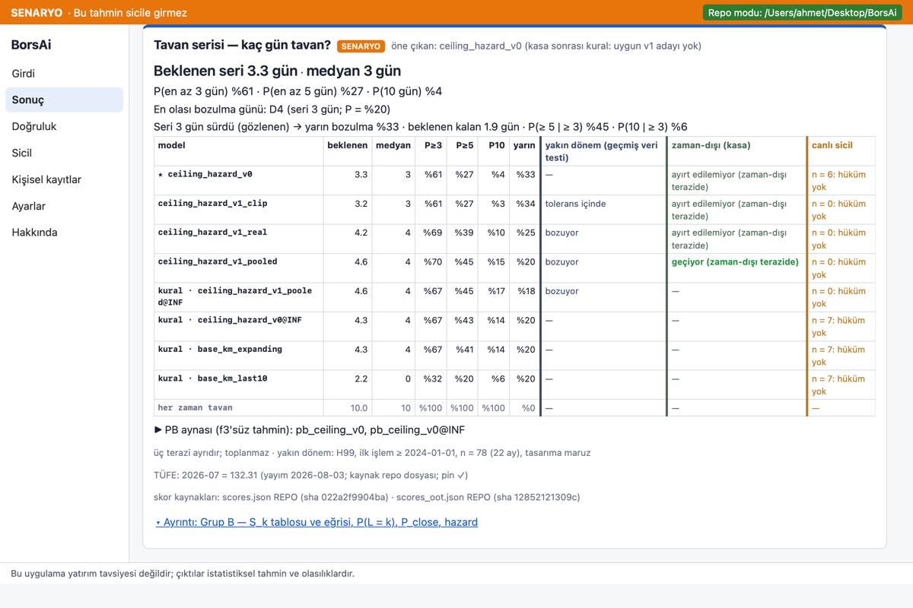
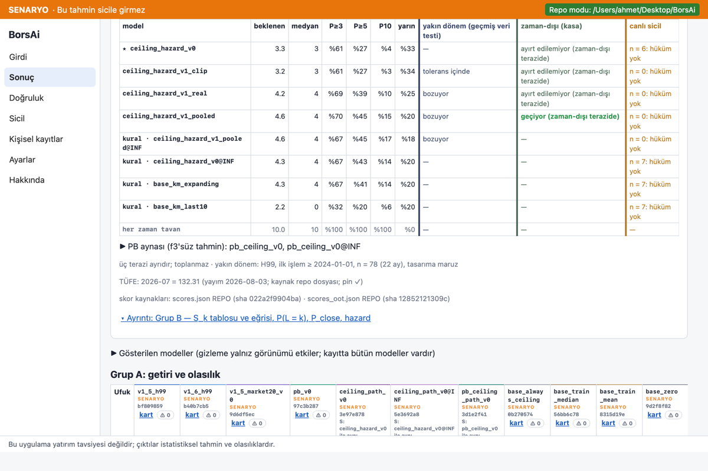
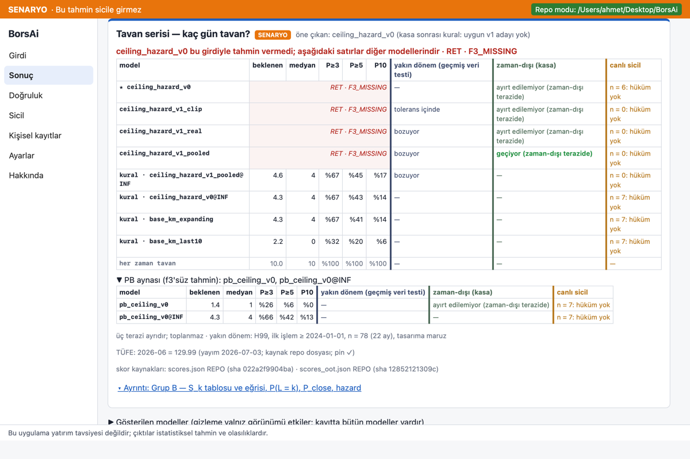
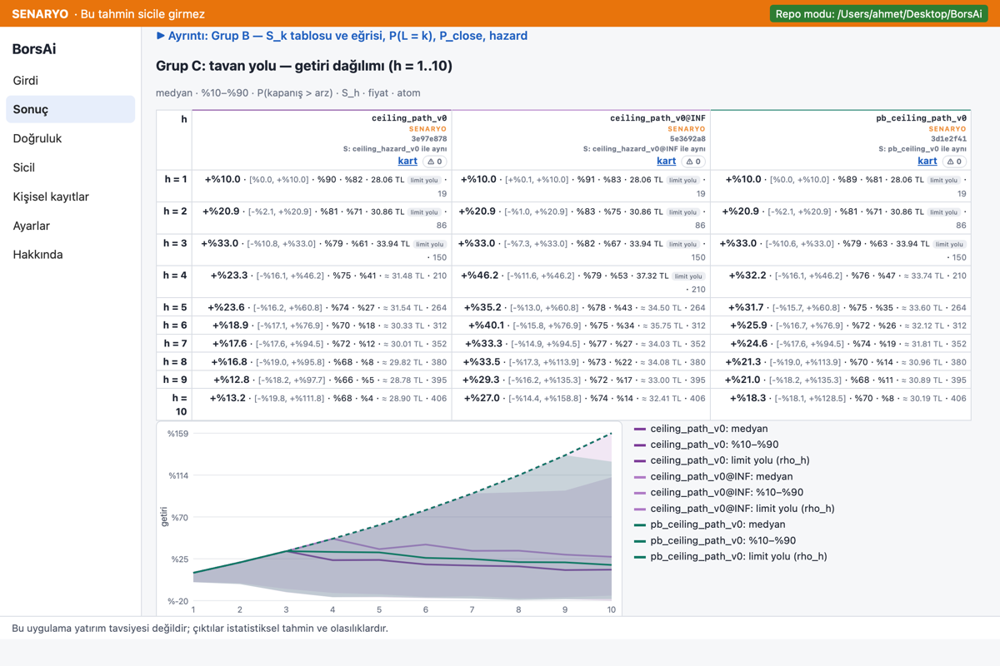
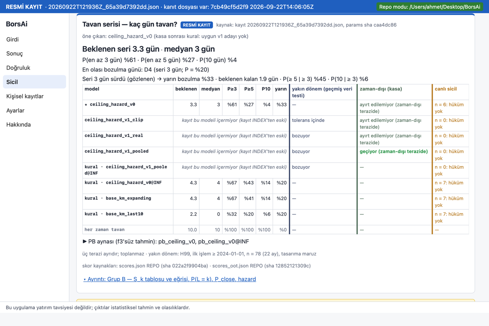

# BORSAI_FAZ7_APP_P1 — Rapor (EK 3 Aşama P1: v1 portu, TÜFE, "Tavan serisi — kaç gün tavan?" kartı)

Görev: `docs/prompts/FAZ7_APP_P1.md` (TASK_ID BORSAI_FAZ7_APP_P1_20260930). Şartname: `docs/app/SPEC_APP_EK3.md` (Fable, 7be8394).
Uygulayıcı: Opus 5.5, 2026-09-30. Yalnız `app/`, `docs/app/p1/` ve K-P1-6 kapsamında `tests/` pin satırı yazıldı; Python,
`models/`, `registry/`, `data/`, `scores/` salt okunur kaldı. Push yok.

## 0. Özet

1. **A (EK 3 §2–§4):** `ceiling_hazard_v1` ailesi (clip, real, pooled, pooled@INF) Rust'ta; TÜFE tablosu (`tufe.rs`) ve
   kaynak seçimi (repo modunda repodaki dosya her tahminde yeniden okunur; bağımsız modda derlemeye gömülü kopya).
   **Parite 23/23**, dört v1 dosyasında 616/616 satır **bit-eşit** (maks |Δ| = 0). Eski 19 altın dosya bayt-eşit.
2. **Gömme:** `PINNED_MODEL_IDS` 19 → 23; `ignored_model_ids` = **tam dört (C) kimliği** (`fall_d10_v0_*`, P4'e kadar).
   Dondur ön koşulu `INDEX_SHA` gerçek INDEX'le (27 giriş, `7e636e8b…`) eşleşiyor; yeni `TUFE_MONTH` engeli testli.
   Geçici klonda yazılan kayıt **27 model**, `tufe` bloğu, Rust parite **23/23 + unsupported 4 (C)**.
3. **D (EK 3 §5):** Sonuç sayfasının başında **"Tavan serisi — kaç gün tavan?"** kartı; Grup B `<details>` altında katlı.
   Gerçek dosyalarla öne çıkan **`ceiling_hazard_v0`**, neden **`RULE_5_5_NONE_ELIGIBLE_V0`** — kural dosyadan uygulanır,
   elle yazılmaz. Kasa sütunu v0/clip/real "ayırt edilemiyor (zaman-dışı terazide)", pooled "geçiyor (zaman-dışı
   terazide)"; yakın dönem clip "tolerans içinde", real/pooled "bozuyor". Ön uçta hesap yok.
4. **K-P1-3:** `commands/scores_oot.rs` (okuma, REPO/EMBEDDED kaynak seçimi, bütünlük; OOT_ROW_NOT_OPEN yalnız açık küme
   bloğunda). Orkestratör eki uygulandı: gömülü kopya **satırsız** (744 206 bayt; kaynak 41 288 743 bayt), repo
   dosyası bir kez okunup önbelleğe alınır.
5. Son kabul: sıralı pytest **864 geçti**, `test.sh` yeşil (cargo 116, vitest 243/243, parity 6, golden_unchanged),
   `gen_golden --check` 30/0. `.app` derlendi (§8).

## 1. Commit'ler

| Adım | Commit | İçerik |
|---|---|---|
| A1 | `29df3e8` | crate: `V1Params`, `hazard::linear` (v0/PB yolu aynen taşındı), v1 dalı, `TUFE_*`/`REGIME_UNKNOWN`, `FEATURE_CLIPPED…`, `Warning.bool_fields`, `tufe.rs`; `dec_cases.json` `real_size`, `tufe_cases.json`; U56; görev dosyası |
| A2 | `d01daa4` | `gen_golden.py` 23 model; 4 × 616 satırlık v1 altın dosyası; yamalı 31 → 43; MANIFEST; `bit_equal_floor.json` 23; parite, kapsama (U53–U55) |
| A3 | `188026f` | `build_embed.rs` PINNED 23 + TÜFE CSV gömme; `predict_all(t)`, `tufe_for_inputs`, `TUFE_MONTH`; parite v1 alanları; Ayarlar/Hakkında TÜFE satırları; U57–U59 |
| D | `8090a45` | kart (`ceiling_summary`, `record_summary`, `featured_ceiling`, yakın dönem okuyucu, `scores_oot.rs`, satırsız gömülü kopya), `render/summary.ts`, Grup B katlı; U60–U62 |
| D (ek) | `2613445` | kart tablosunun sola hizası; yalnız geliştirmede çalışan P1 görüntü adımları (`VITE_BORSAI_DEMO_P1=1`) |
| APPPIN | `107fd98` | `tests/test_faz7c_model.py::test_app_golden_pins_unchanged`: `gen_golden --check` dosya sayısı 25 → 30 (yalnız pin satırları; K-P1-6) |
| R | (bu commit) | `docs/app/p1/RAPOR.md`, `test_runs.txt`, `ekran/*.png` |

Taban: `a9ffa4a` (= origin/main). Ağaçta yalnız izinli iki izlenmeyen dosya vardı; `docs/prompts/LIVE_NETGL_D10.md`'ye dokunulmadı.

Önemli sha'lar: INDEX `7e636e8bf64b25d79bac04f4bf78b9f870cded8d4d1c10009b6926941e4edb59` (27 giriş); TÜFE öneki
(pin, 2026-08) `3d61cbcfca2453cfce476d4cfaae38a3c77c68a4d168641162d1627e731a567b`; v1 params sha8: clip `f3a14753`, real
`d81dad3d`, pooled `e03e71e0`, pooled@INF `7d7c9d1e`.

## 2. U53–U63 sonuçları ve EK 3 §11 beklentisiyle karşılaştırma

| # | Test (yöntem) | Sonuç | EK 3 §11 beklentisi / fark |
|---|---|---|---|
| U53 | Parite 23/23 (`--test golden`) | **23/23**, 10 143 satır, maks \|Δ\| 1.14e-13 (yalnız eski PB satırları); v1 dosyaları 616 satır, **616/616 bit-eşit**, maks \|Δ\| 0; `f1r_raw` ve `tufe_index_used` birebir; `predict_sources_unchanged` 9 dosya (+`borsai/tufe.py`); `bit_equal_floor` 23 taban (v1 tabanları 616, ilk yeşil koşu) | Beklenti: 23/23, v1 maks \|Δ\| < 1e-12 → tuttu (Δ = 0). Satır ≈ 609 beklenmişti; 616 (uç durumlar 47). |
| U54 | Kapsama (`--test coverage`, `v1_coverage`) | `TUFE_MISSING` her girdi yolunda ≥ 2 (yok/null 672, boş 4, bool 2, sayı değil 8, ≤ 0 4, `tufe_refusal` 4); `TUFE_NOT_PIT` 2; `TUFE_FILE_MISMATCH` 2; `REGIME_UNKNOWN` pooled 4 / @INF 4; `regime_source` LIVE_VALUE 665 / ALLOC_REGIME_INPUT 145; `regime_value_used = 1` 113; her kırpma sütununda alt/üst ≥ 2 (f1 yalnız clip, f1r yalnız real/pooled); ≥ 2 sütunlu `clipped_features` 109; `F3_MISSING` clip/real/pooled 14'er; @INF'te `clipped`/`clipped_features` her satırda null | Tuttu. "F3_MISSING dört modelde" okunamaz: @INF girdi kullanmaz (muafiyet MANIFEST'te). |
| U55 | `golden_unchanged.sh` | 16 eski dosya `0b67f5d` ile, 3 tavan yolu dosyası + 3 koşullu dosya `7133991` ile bayt-eşit; `_patched_params.jsonl` ilk 19 (`0b67f5d`) ve ilk 31 (`7133991`) satır bayt-eşit; `dec_cases.json` eski 10 bölüm aynı | Tuttu. |
| U56 | `dec_semantics real_size` + `tufe_semantics` | `real_size` 10 çift: metin (`str(Decimal)`) ve binary64 birebir, taşma → DOMAIN_ERROR (Python `Overflow`), k-katı değişmezliği Δ = 0; `month_for` 8, `index_for` (var olan, eksik ay, ek satırlı kopyada bulunan), NOT_PIT bekçisi (biçim denetimsiz tablo), `prefix_sha256` (2019-11, 2026-08), pin tutar / eski satırı değişmiş kopyada `TUFE_FILE_MISMATCH`, 11 `parse` reddi (CRLF, eksik ay, üç noktalı endeks, boşluklu endeks, sıfır endeks, yayım günü 2, yanlış yayım ayı, bülten kimliği, http, başlık, ay boşluğu) | Tuttu. Risk (1) (`div_exact` sonra `div_round`) ilk günde kapandı. |
| U57 | `stage3::tufe_source_and_blocker` + vitest (`freeze.test.ts` U57) | (a) repo dosyası → real/pooled dolu; (b) 2026-09 satırı eklenmiş dosyada T = 2026-11-10 ile ay bulunur, yeniden derleme yok; (c) ay yokken iki model `TUFE_MISSING`, ekleme komutu, `TUFE_MONTH` engeli, **`borsai.freeze` çağrısı 0**, `registry/records` oluşmaz; (d) T boş → `T_UNKNOWN`, engel değil; (e) eski satırı değişmiş kopya → `TUFE_FILE_MISMATCH`, engel değil, sarı satır; (f) bağımsız mod gömülü tablo, Hakkında satırı; vitest: komut metni `borsai/tufe.py`'deki `APPEND_COMMAND` ile birebir | Tuttu. |
| U58 | `integrity` + `build_embed` | gömülü 23 dosya sha = INDEX, `check_params` hepsinde (v1 dalı); `winsor.f2` silinmiş clip kopyası ve `penalized = true` pooled kopyası → `INTEGRITY_FAILED` / PARAMS_INVALID; **`ignored_model_ids` == dört (C) kimliği** (K-P1 bağlam 1: EK 3'ün `[]` beklentisi P1'de böyle okunur); TÜFE tablosu gömülü; deflatörlü model varken tablo yoksa derleme kırılır | Tuttu (J31 kalıbı). |
| U59 | `e2e_freeze_tmp_repo.sh` + `records_parity` | geçici klonda PB ve talep katlı kayıt **27 model**, `tufe` 2026-08 = 134.75 (yayım 2026-09-03), `model_inputs.tufe_index` = blok endeksi, talep katlı kayıtta real/pooled dolu; Rust parite **23/23** \|Δ\|max 0 + uygulamada henüz olmayan 4 (C); eski 7 kayıt "16/16 + kayıtta yok: 7"; asıl repo `registry/` sha listesi birebir aynı | Tuttu. |
| U60 | `stage2::ceiling_summary_fixtures` + vitest `summary.test.ts` + ekran | sentetik "kasa kapalı" fixture: öne çıkan v0 / `VAULT_CLOSED_V0_DEFAULT`, "kasa: bekliyor"; değerler `ceiling_display` satırlarıyla birebir (`S[2]`, `S[4]`, `S[9]`, beklenen, medyan); `mode_l` üç dal (0, orta, 10); j = 0'da koşullu satır yok, j = 2'de var; üç terazi üç sınıf; Grup B `<details>` kapalı; **gerçek dosyalarla** öne çıkan v0 / `RULE_5_5_NONE_ELIGIBLE_V0` ve terazi sütunları (§5) | Tuttu. EK 3 §11'in "VAULT_CLOSED" beklentisi kasa açılmadan yazılmıştı; bugün kasa açık → `RULE_5_5_NONE_ELIGIBLE_V0` (görev bağlamı 4). |
| U61 | `stage2::featured_ceiling_rules` | kasa bloğu yok → v0; (a) clip k1–k3 → clip; (b) geçiyor ama "bozuyor" → uygun değil; (c) 0.1801 / 0.1809 → düşük olan; yuvarlanınca eşit (0.18041 / 0.18049 → 0.180) → basit olan; 0.179 / 0.180 → düşük olan; (d) blok yok → k3 = false; (e) `ci95[1] = 0.0` → uygun değil; **gerçek dosya: v0, `RULE_5_5_NONE_ELIGIBLE_V0`** (clip k1 ✗; real k1 ✗, k3 ✗; pooled k1 ✓ k2 ✓ k3 ✗); gövdede toplama/istatistik çağrısı yok (statik) | Tuttu. EK 3'ün (c) örneği (0.1804 / 0.1806) yuvarlanınca eşit değil; eşit çift 0.18041 / 0.18049 kullanıldı. |
| U62 | `stage3::official_summary_uses_record_only` + vitest | 0.5^k S'li 23 modelli kayıt: P(≥ 3) = 0.125, koşullu 0.5^(k − j), `record_summary` saf (predict_all yok); 16 modelli kayıtta v1 satırları "kayıt bu modeli içermiyor" (listeden kalkmaz, K4); TÜFE satırı kaydın `tufe` bloğundan; beyan resmi verinin önündeyse kartın koşullu satırı yalnız "resmi kapanış bekleniyor" (U52 kümesi karta genişledi: `decl_flow.ts` havuzu `renderCeilingSummary`) | Tuttu. |
| U63 | `stage2::u7_veyas_four_refusals`, `integrity::predict_all_covers_index` + ekran | VEYAS: **8 RET** (v1_5_h99, v1_6_h99, v1_5_market20_v0, ceiling_hazard_v0, ceiling_path_v0, v1 clip/real/pooled; hepsi `F3_MISSING`) + **15 dolu** (pooled@INF dahil); NETGL T = 2026-09-17 → TÜFE 2026-07 = 132.31, real/pooled dolu | Tuttu. |

EK 3 §11'deki diğer sayılar:
- VEYAS pooled@INF: S₁ = 0.8560854…, S₁₀ = 0.1699413 (beklenti 0.856 ve ≈ 0.17). VEYAS'ın T'si 2026-08-20 (TÜFE 2026-06 =
  129.99); EK 3 "T 2026-09" yazmıştı. f3 boş olduğu için v1 üçü TÜFE'den önce reddeder.
- NETGL: `f1r_raw` = **1 687 703 121.457…** (EK 3'ün elle hesabı 1 687 703 424.08 idi; doğru değer 2 233 000 000 / 1.3231);
  real ve pooled winsor içinde, `clipped false`, `clipped_features []`, pooled `regime_value_used 0` (LIVE_VALUE).
- Ortak 392 satırda real ve pooled 334 satırda `TUFE_MISSING`; kalan satırlar TÜFE'den önce girdi reddi verir (EK 3 390
  tahmin etmişti). clip 334 tahmin, @INF 392 tahmin.
- Canlı: v0 `n = 6: hüküm yok` (dosyada `live.n_scored = 6`; EK 3 7 yazmıştı), v1 `n = 0`, kurallar `n = 7`.
- Test sayısı artışı: cargo +22 (beklenti ≈ 30), vitest +21 (≈ 45), `test_gen_golden.py` +2 (≈ 6).

## 3. K-P1-3 okuyucusunun kapsamı (`app/src-tauri/src/commands/scores_oot.rs`)

- **Okunan:** `schema_version` (yalnız `borsai.scores_oot/1`), `generated_at_utc`; blok başına (`oot_pre_h99`,
  `oot_pre_h99_sealed`, `oot_pre_h99_all`, `post_d1`, `post_d1_sealed`, `post_d1_all`) model blokları ve hücreler. Kart
  yalnız `oot_pre_h99_sealed` bloğunun `label == "birincil"` hücresini (verdict, diff, ci95, n) ve öne çıkarma kuralı için
  v0'a karşı S · RPS hücresinin `ci95[1]`'ini okur. Hiçbir satır çizilmez, hiçbir hücre hesaplanmaz.
- **Kaynak seçimi:** ayar REPO ve repo modu → `<repo>/scores/scores_oot.json`; değilse gömülü kopya. Repo dosyası bir kez
  okunur ve önbelleğe alınır; yol, boyut ya da değişme zamanı değişmedikçe yeniden ayrıştırılmaz (`repo_parse_count`
  testi). Önbellekte satırsız belge tutulur.
- **Bütünlük (fail-closed; kart yerine ihlal):** sürüm; `n_scored < 10` iken hücre (`OOT_CELLS_BELOW_MIN_N`); hüküm/aralık
  (`VERDICT_WITHOUT_INTERVAL`, `UNDECIDED_WITH_INTERVAL`; `cells`, `by_year`, `by_regime`); `n_live + n_late ≠ 0`
  (`OOT_LIVE_COUNTS_NONZERO`); **`OOT_ROW_NOT_OPEN` yalnız `oot_pre_h99` satırlarına**; `oot_pre_h99_sealed` ve
  `oot_pre_h99_all`'da yalnız `vault == "SEALED"` kapalı satır meşru (SEALED olmayan kapalı satır yine ihlal); D1 sonrası
  satırlarında `open` alanı yok, kural uygulanmaz. İhlal metni arz kodu basmaz, yalnız sayı. Gerçek dosya temiz geçiyor.
- **Orkestratör eki (bağımsız mod gömmesi):** `build.rs` tam dosyayı değil süzülmüş kopyayı gömer
  (`build_embed.rs: filter_scores_oot`): üst düzeyde `schema_version`, `generated_at_utc`, `code`, `cohort_sha256`,
  `definitions`; her alt küme bloğunda `models` dışındaki alanlar (başlık, ölçek, alt küme adı ve sayaçlar) ve `models[]`
  öğelerinin `rows` ve `retro_info` dışındaki bütün alanları; üst düzey `retro_info` yok. Eklenen `embedded_copy`:
  `source_sha256` (kaynak dosya), `rows_embedded: false`, not "satırlar gömülmedi …". **Gömülü boyut 744 206 bayt**
  (kaynak 41 288 743 bayt). Süzme hesap değildir: `stage2::scores_oot_reader_real_file` gömülü altı bloğun repo
  dosyasının satırsız hâline, her modelin `cells`'inin repo dosyasındakine ve beş üst alanın birebir eşit olduğunu sınar.
  Not: D1 sonrası model bloklarındaki `retro_info` (arz kodu taşır) de gömülmedi; blok başlık/ölçek alanları "sayaç"
  dışında olsa da P3 panel başlığı için tutuldu.
- **P3'e kalan:** Doğruluk sekmesindeki panel (`render/accuracy_oot.ts`), satır tablosu, RETRO listesi, retro ticker süzgeci.

## 4. Gerçek dosyalarla kart çıktısı (metin)

Kaynaklar: `scores/scores.json` (sha12 `022a2f9904ba`), `scores/scores_oot.json` (sha12 `12852121309c`), gömülü INDEX.
Fixture: `app/tests/fixtures/ui/summary_real_netgl_j0.json` (NETGL girdileri, T = 2026-09-17).

- **Başlık:** "Tavan serisi — kaç gün tavan?" · SENARYO · **öne çıkan: ceiling_hazard_v0 (kasa sonrası kural: uygun v1 adayı yok)**
- **Neden:** `RULE_5_5_NONE_ELIGIBLE_V0`. Aday denetimi (dosyadaki alanlar):

| Aday | k1: kasa birincil (verdict; model RPS) | k2: v0'a karşı üst uç < 0 | k3: yakın dönem | Uygun |
|---|---|---|---|---|
| clip | ayırt edilemiyor (0.2306) ✗ | −0.0161 ✓ | tolerans içinde ✓ | hayır (k1) |
| real | ayırt edilemiyor (0.1862) ✗ | −0.0347 ✓ | bozuyor ✗ | hayır |
| pooled | geçiyor (0.1573) ✓ | −0.0381 ✓ | bozuyor ✗ | hayır (k3) |

- **Öne çıkan özeti (NETGL, j = 0):** Beklenen seri **3.3 gün** · medyan **3 gün** · P(en az 3 gün) %61 · P(en az 5 gün)
  %27 · P(10 gün) %4 · En olası bozulma günü: D4 (seri 3 gün; P = %20).
- **Gözlenen j = 3 (ekranda, `data/outcomes/NETGL.csv`):** Seri 3 gün sürdü (gözlenen) → yarın bozulma %33 · beklenen kalan
  1.9 gün · P(≥ 5 | ≥ 3) %45 · P(10 | ≥ 3) %6.
- **Adaylar tablosu** (beklenen | medyan | P≥3 | P≥5 | P10 | yakın dönem | zaman-dışı (kasa) | canlı sicil):

| Rol | Model | Değerler | Yakın dönem | Zaman-dışı (kasa) | Canlı |
|---|---|---|---|---|---|
| ★ | ceiling_hazard_v0 | 3.3 · 3 · %61 · %27 · %4 | — | ayırt edilemiyor (zaman-dışı terazide) | n = 6: hüküm yok |
| aday | ceiling_hazard_v1_clip | 3.2 · 3 · %61 · %27 · %3 | tolerans içinde | ayırt edilemiyor (zaman-dışı terazide) | n = 0: hüküm yok |
| aday | ceiling_hazard_v1_real | 4.2 · 4 · %69 · %39 · %10 | bozuyor | ayırt edilemiyor (zaman-dışı terazide) | n = 0: hüküm yok |
| aday | ceiling_hazard_v1_pooled | 4.6 · 4 · %70 · %45 · %15 | bozuyor | geçiyor (zaman-dışı terazide) | n = 0: hüküm yok |
| kural | ceiling_hazard_v1_pooled@INF | 4.6 · 4 · %67 · %45 · %17 | bozuyor | — | n = 0: hüküm yok |
| kural | ceiling_hazard_v0@INF | 4.3 · 4 · %67 · %43 · %14 | — | — | n = 7: hüküm yok |
| kural | base_km_expanding | 4.3 · 4 · %67 · %41 · %14 | — | — | n = 7: hüküm yok |
| kural | base_km_last10 | 2.2 · 0 · %32 · %20 · %6 | — | — | n = 7: hüküm yok |
| PB aynası (katlı) | pb_ceiling_v0 | 3.8 · 3 · %63 · %35 · %8 | — | ayırt edilemiyor (zaman-dışı terazide) | n = 7: hüküm yok |
| PB aynası (katlı) | pb_ceiling_v0@INF | 4.3 · 4 · %66 · %42 · %13 | — | — | n = 7: hüküm yok |
| sabit | her zaman tavan | 10.0 · 10 · %100 · %100 · %100 | — | — | — |

- Alt satırlar: "üç terazi ayrıdır; toplanmaz · yakın dönem: H99, ilk işlem ≥ 2024-01-01, n = 78 (22 ay), tasarıma maruz";
  "TÜFE: 2026-07 = 132.31 (yayım 2026-08-03; kaynak repo dosyası; pin ✓)"; skor kaynakları; "▾ Ayrıntı: Grup B …".
- **VEYAS (f3 boş):** öne çıkan v0 "bu girdiyle tahmin vermedi · RET · F3_MISSING"; v1 üçü `RET · F3_MISSING` (terazi
  sütunları yerinde); pooled@INF 4.6 · 4 · %67 · %45 · %17; PB aynası açık (pb_ceiling_v0 1.4 · 1 · %26 · %6 · %0).
- **Arz sayfası (NETGL, 16 modelli resmi kayıt):** RESMİ KAYIT · "kaynak: kayıt 20260922T121936Z_65a39d7392dd.json, params
  sha caa4dc86"; v0 değerleri kayıttaki S'ten (senaryoyla aynı girdi olduğu için aynı sayılar); v1 dört satırı "kayıt bu
  modeli içermiyor (kayıt INDEX'ten eski)".

Terazi değerleri hiçbir yerde toplanmaz, ortalanmaz; "geçiyor" metni yalnız dosyadaki `verdict`'ten gelir (U19 taraması
geçti).

## 5. Ekran görüntüleri (`docs/app/p1/ekran/`)

Koşu: `VITE_BORSAI_DEMO=1 VITE_BORSAI_DEMO_P1=1 npm run tauri dev -- --features snapshot`; uygulama verisi ve görüntüler
geçici dizinde; `app/docs/screens/`'e yazılmadı; asıl repo `registry/` sha listesi öncesiyle aynı.

| Dosya | İçerik |
|---|---|
| `p1_00_ayarlar_tufe.png` | Ayarlar: repo doğrulaması, "TÜFE tablosu … son ay ve pin" satırı |
| `p1_01_veyas_kart.png` | VEYAS: kart, öne çıkan RET, v1 RET satırları, PB aynası açık, TÜFE 2026-06 |
| `p1_02_veyas_kart_tablo.png` | VEYAS: adaylar tablosu ve üç terazi sütunu |
| `p1_03_veyas_grup_b_katli.png` | VEYAS: katlı Grup B |
| `p1_04_netgl_kart_j3.png` | NETGL, gözlenen j = 3: kart, koşullu satır, adaylar, üç terazi, TÜFE |
| `p1_05_netgl_adaylar_j3.png` | NETGL j = 3: adaylar tablosu ("yarın" sütunu) ve altında Grup A |
| `p1_06_netgl_kart_j0.png` | NETGL j = 0: koşullu satır yok |
| `p1_07_netgl_grup_b_katli.png` | NETGL: katlı Grup B ("▶ Ayrıntı: Grup B …") ve Grup C |
| `p1_08_netgl_grup_b_acik.png` | "Ayrıntı" bağlantısıyla açılmış Grup B |
| `p1_09_arz_sayfasi_netgl_kart.png` | Arz sayfası (resmi kayıt): kart kayıttan; v1 "kayıt bu modeli içermiyor" |
| `p1_10_hakkinda_tufe.png` | Hakkında: 23 gömülü model, gömülmeyen dört (C), gömülü TÜFE 2026-08, pin ✓ |







## 6. Test sayıları

| Koşu | Taban (a9ffa4a) | Son (107fd98 + rapor) |
|---|---|---|
| `bash app/scripts/test.sh` | cargo 94 · vitest 222 · parity 4 · golden_unchanged yeşil | **cargo 116 · vitest 243 · parity 6 · golden_unchanged yeşil** |
| `gen_golden --check` | 25/0 | **30/0** |
| pytest | paralel 864 geçti (9 dk 35 sn) | **sıralı 864 geçti** (15 dk 37 sn; ayrıntı `test_runs.txt`) |
| e2e betikleri | — | `e2e_freeze_tmp_repo.sh` yeşil (U59), `e2e_personal_isolation.sh` yeşil |

Kırılıp yeniden pinlenen satırlar (K-P1-6; mantık değişmedi): vitest `results.test.ts` (19 → 23 sütun, U7 → U63: 8 RET +
15 dolu, filigran sayısı 22 → 26), `freeze.test.ts` U30 (19 → 23), `scenario.test.ts` (19 → 23); Rust `integrity.rs`,
`build_embed.rs`, `stage2.rs` (kart fixture 19 → 23), `stage3.rs` (16/16 + kayıtta yok 3 → 7; parite 19/19 → 23/23),
`e2e.rs` (kayıt 19 → 27 model); UI fixture'ları `BORSAI_UPDATE_UI_FIXTURES=1` ile Rust'ın gerçek çıktısından; Python
`tests/test_faz7c_model.py` 25 → 30 (APPPIN `107fd98`).

## 7. Sapmalar, kararlar, dosya listesi dışı dokunuşlar

1. **EK 3 §1 P1 dosya listesi dışında dokunulan `app/` dosyaları** (şartnamenin kendi gereği için asgari tesisat):
   `src/api.ts` (`predictAll(t)`, `ceilingSummary`, `recordSummary`), `src/screens/inputs.ts` (T'yi `predict_all`'a verir),
   `src/screens/about.ts` (U57(f) Hakkında TÜFE satırı), `src/render/freeze.ts` (TUFE_MONTH engelinin komut kutusu,
   §3.4), `src/render/registry.ts` + `src/screens/registry.ts` + `src/state.ts` (U62: arz sayfasında kart),
   `src-tauri/src/commands/scenario.rs` (kişisel kayıt tahmini de T'den TÜFE alır), `src/dev/demo.ts` (yalnız geliştirme:
   görüntü adımları); testler `decl_flow.ts`, `u52_declaration.test.ts`, `registry.test.ts`, `screens_invoke.test.ts`
   (U52 havuzuna kart, arz sayfası komut kümesine `recordSummary`, sahte `invoke`'a iki komut).
2. **`APPEND_COMMAND` yorumlayıcısı (K-P1-5):** Rust sabiti Python metninin birebir kopyasıdır (test: `borsai/tufe.py`
   ile karşılaştırma). Metin `.venv/bin/python` ile başladığı için, repo modunda ekranda ilk sözcük ayardaki Python yoluyla
   (repo içindeyse göreli) değiştirilir; bağımsız modda Python metni aynen. Uygulama komutu çalıştırmaz. Yeni kodda yol
   `PathBuf::join` ile kurulur; Unix'e özel test (`tufe_source_and_blocker`) `#[cfg(unix)]` ile sınırlandı.
3. **TÜFE girdisi kayıt biçimindedir:** `predict_all` deflatörlü model varken girdiye `tufe_index` ve `tufe_refusal`
   anahtarlarının ikisini de yazar (Python kaydı gibi; biri null). EK 3 §3.3 "ya da" diyordu; sonuç aynıdır.
4. **Ön koşul fixture'ları saatten bağımsız:** `preflight_at(…, today)` eklendi; `preflight_ok.json` T = 2026-10-15 (TÜFE
   2026-08) ve bugün 2026-10-05; `preflight_blocked.json` T = 2026-09-17; yeni `preflight_tufe_month.json`. TÜFE satırının
   dosyaya bağlı alanları (yol, sha, son ay) aylık eklemeyle değişmesin diye fixture'da sabitlendi.
5. **e2e:** klonun TÜFE tablosu T'nin ayını kapsamıyorsa ay sonuna kurgusal satır eklenir (yalnız klonda; bugün gerekmedi).
6. **`mode_break_day`:** "D{mode_l + 1}" gün numarası Rust'ta verilir; ön uçta toplama bile yok.
7. **Kart fixture'ları:** gerçek dosyalara bağlı üç fixture (`summary_real_*`) bayt karşılaştırılmaz (`score_hints.json`
   kalıbı; skor dosyaları yeniden üretilince değişir); asıl kabul Rust testindeki doğrudan beklentilerdir. Sentetik
   fixture'lar (`summary_closed_*`, `summary_mode_branches`, `summary_record*`) bayt karşılaştırılır.
8. **U61 (c) örneği:** EK 3'ün 0.1804 / 0.1806 çifti 3 haneye yuvarlanınca eşit değildir; eşit çift 0.18041 / 0.18049.
9. **Kasa sütunu kural satırlarında:** veri güdümlüdür; birincil hücresi olan PB satırı (`pb_ceiling_v0`) da kendi kasa
   hükmünü gösterir; birincil hücresi olmayan kurallar "—".
10. **Yamalı parametrelerde silme:** yama dili silme bilmez; "silinir" satırları null / boş sözlük / sütunsuz kopyayla
    aynı ret yoluna götürüldü (Python'da ölçüldü; hepsi beklenen kod).

## 8. Derleme

`source app/scripts/env.sh && cd app && npm run tauri build -- --bundles app` → exit 0.
`app/src-tauri/target/release/bundle/macos/BorsAi.app`; **`BorsAi.app/Contents/MacOS/borsai-app` sha256
`46fc63425894136a8d63ffa719e630fd07664c647eab6552c8b11faec67c570d`** (7 503 712 bayt; gömülü HEAD `107fd982db87`, INDEX
`7e636e8b…`, 23 model, TÜFE tablosu 2026-08'e kadar, satırsız `scores_oot` kopyası). `/Applications`'a kopyalanmadı.

## 9. Proje sahibi için kurulum

Önce çalışan uygulamayı kapat (Cmd+Q), sonra:
```
cd ~/Desktop/BorsAi
ditto app/src-tauri/target/release/bundle/macos/BorsAi.app /Applications/BorsAi.app
open /Applications/BorsAi.app
```

İlk açılışta Ayarlar'da repo kökü doğrulanınca (INDEX 27 giriş artık gömülüyle eşit) dondur akışı yeniden çalışır.
TÜFE: yeni ay (2026-09) bülteni yayımlanınca (m + 1'in 3'ü, 10:00) Python tarafında `build_tufe_csv.py --append-month`
ile eklenir; repo modunda uygulama yeniden derlenmeden görür. T'nin ayı − 2 dosyada yoksa dondur sihirbazı `TUFE_MONTH`
engeliyle durur ve komutu gösterir (bugünden itibaren T ≥ 2026-11-01 olan arzlarda 2026-09 satırı gerekir).

## 10. Ö-görevleri (Python tarafı; düzeltilmedi)

- **Ö-P1-1:** `borsai/tufe.py: APPEND_COMMAND` `.venv/bin/python` ile başlıyor (Mac/Linux düzeni); Windows için yorumlayıcıyı
  sabitlemeyen bir metin (ör. `python` ya da `{python}` yer tutucusu) düşünülebilir. Uygulama bugün repo modunda
  ayardaki yolu gösteriyor.
- **Ö-P1-2 (not):** Python `_tufe_input` / `_linear_v1` sözlük ya da liste gibi hash'lenemeyen `tufe_refusal` /
  `alloc_regime` değerlerinde `TypeError` fırlatır; Rust bu uç girdilerde `TUFE_MISSING` / `REGIME_UNKNOWN` döner.
  Kayıt yolunda bu tipler oluşmaz; altın vektörde yok.
- **Ö5 (EK 3 §12):** `featured_ceiling` sonucunu `MODELS.md`'deki insan kararıyla karşılaştıran Python testi hâlâ yok
  (bugün ikisi de v0).

## 11. P2 / P3 / P4 için notlar

- **P2 (D1 sonrası):** `hazard::linear` hazır (v0 yolunun doğrusal öngörücüsü `LinOut.eta`); `Warning.bool_fields`
  `to_json` sırası `text_fields`'tan sonra. `record_summary` kartına D1 sonrası satırı eklenebilir (resmi j ≥ 1).
- **P3 (zaman-dışı panel):** `commands/scores_oot.rs` okuyucu, önbellek ve bütünlük hazır; önbellek satırsız belge
  tutar — panel satır tablosu için repo modunda açık küme satırlarını ayrı (süzgeçli) okumak gerekir. Gömülü kopyada
  satır yok (bağımsız modda satır tablosu "repo modu ister"). `IntegrityProblem` ve `check_cell` paylaşılıyor.
- **P4 ((C)):** `build_embed` tek satır (`PINNED_MODEL_IDS` 27) ve `tests/build_embed.rs`/`integrity.rs`'teki dört (C)
  beklentisi `[]` olur; `featured_fall` `scores::featured_ceiling` kalıbını izleyebilir (`FEATURED_CANDIDATES` benzeri
  sabitler, dosyadan k1–k3). TÜFE altyapısı (h99/pooled) hazır.
- Eski ekran görüntüleri (`app/docs/screens/`) Grup B'yi açık gösterir; güncellemek için `bash app/scripts/screens.sh`.
