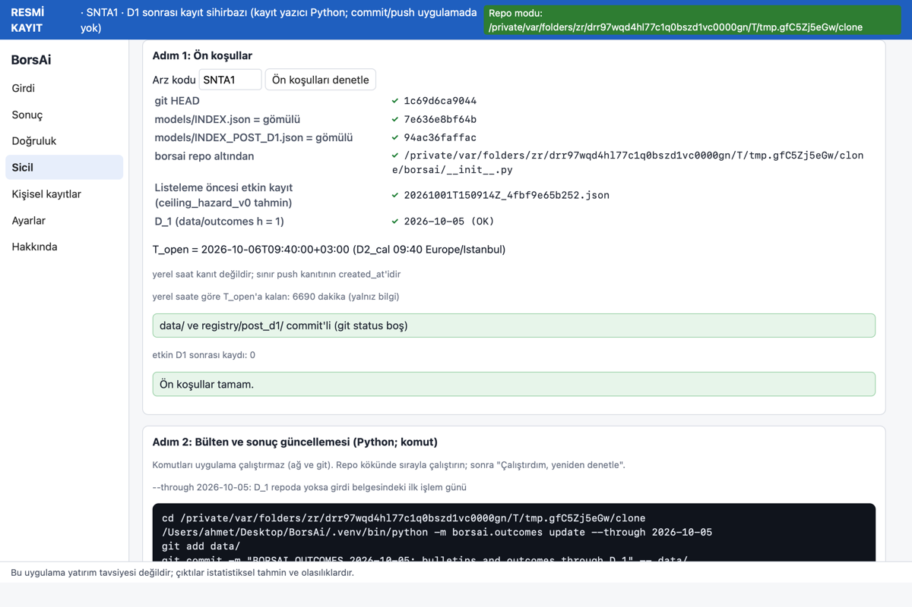
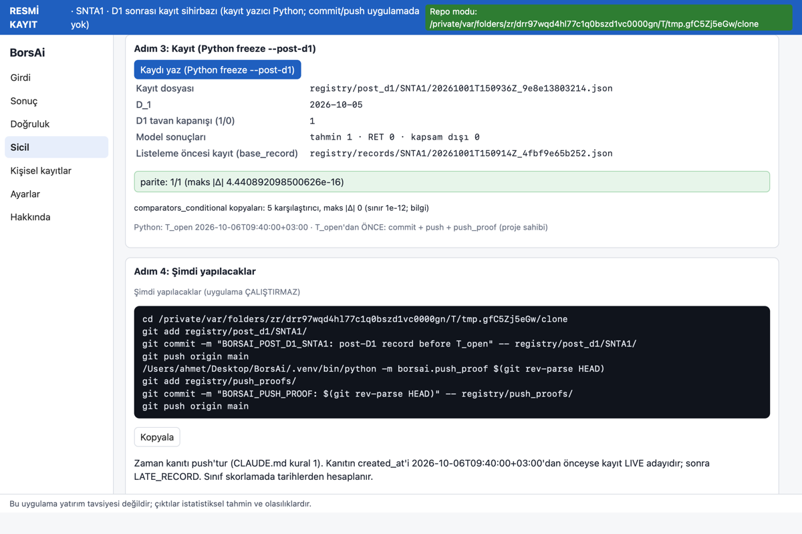
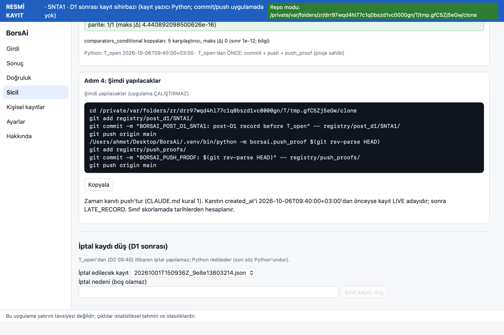
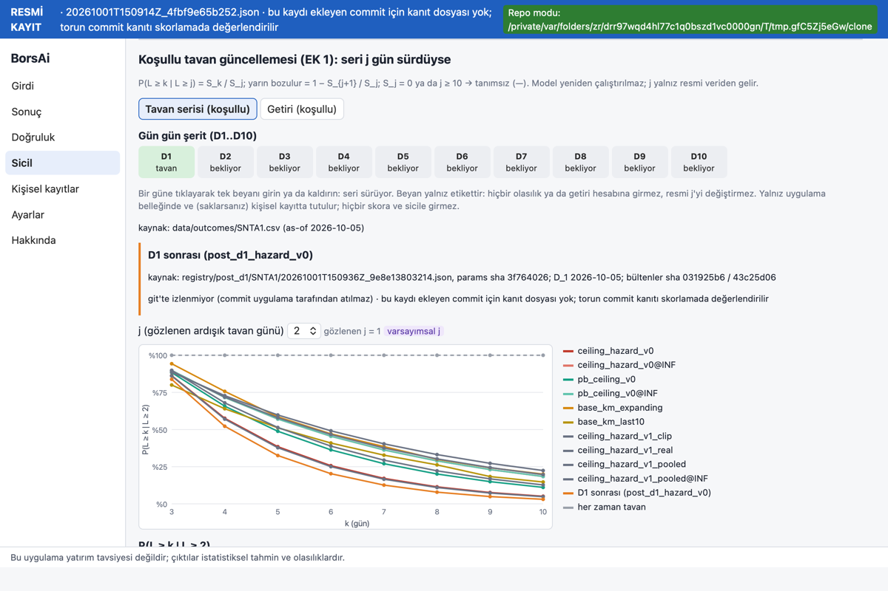
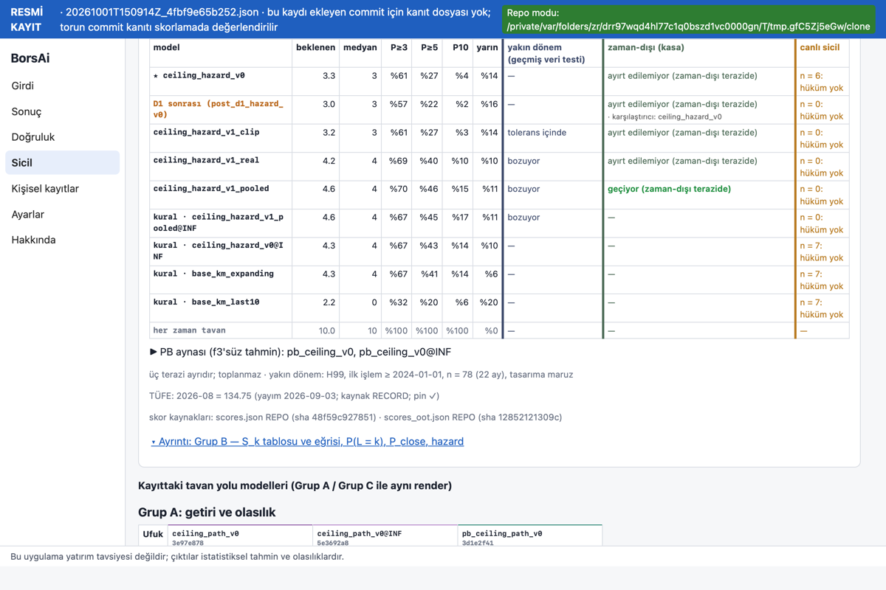
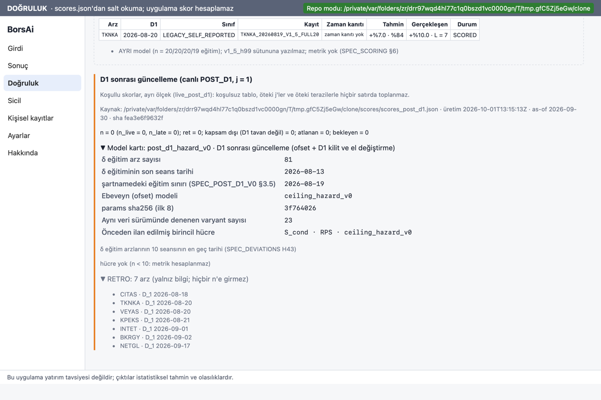

# BORSAI_FAZ7_APP_P2 — Rapor (EK 3 Aşama P2: D1 sonrası güncelleme, `post_d1_hazard_v0`)

Görev: `docs/prompts/FAZ7_APP_P2.md` (TASK_ID BORSAI_FAZ7_APP_P2_20261001). Şartname: `docs/app/SPEC_APP_EK3.md` §6, §9 (P2),
§10.2, §11 (Fable, `7be8394`). Uygulayıcı: Opus 5.5, 2026-10-01. Yalnız `app/`, `docs/app/p2/`, görev dosyası ve K-P2-6
kapsamında `tests/` pin satırları yazıldı; Python, `models/`, `registry/`, `data/`, `scores/` salt okunur kaldı. Push yok.

Kullanıcı sorusu: **"tavan serisi yarın bozulur mu?"**

## 0. Özet

1. **Port (B1–B2):** `post_d1_hazard_v0` Rust'ta (`Kind::PostD1`, `params::parse_post_d1`, `post_d1::{evaluate_d1,
   predict_post_d1}`, çıktı ve H23 öneksiz kodlar). Altın dosya **238 satır, parite 238/238**, maks |Δ| **1.78e-15**,
   bit-eşit 204 (%85.7); `d1_turnover_ratio` metni her satırda birebir. Yamalı +8 (43 → 51). Eski 23 altın dosya ve
   `_patched_params.jsonl`'ın ilk 43 satırı bayt-eşit.
2. **Gerçek D1 paritesi (K-P2-4):** eski kohortun kasa dışı POST_D1 kayıtlarıyla **71/71** (59 PREDICTED · 9 NOT_APPLICABLE
   `D1_NOT_CEILING` · 3 REFUSED `F3_MISSING`), maks |Δ| 8.88e-16. Önceden yazılı beklentiyle birebir. Kasa dizinleri açılmadı.
3. **Gömme ve bütünlük (B3):** ikinci dizin `INDEX_POST_D1.json` gömülü (sha = BUILD_INFO); ebeveyn ve yol sha zinciri;
   bozuk kopyada `INTEGRITY_FAILED / POST_D1_PARENT_MISMATCH` (U67). `predict_all` hâlâ 23 sütun; bu türü çalıştırmaz.
4. **Arayüz (B4):** koşullu sekmede **"D1 sonrası (post_d1_hazard_v0)"** satırı (yalnız resmi kayıttan, yalnız j ≥ 1),
   kaynak satırı, "Getiri (koşullu)" ek kartı. "Tavan serisi" kartında POST_D1 satırı: zaman-dışı "ayırt edilemiyor
   (zaman-dışı terazide)" + görünür "karşılaştırıcı: ceiling_hazard_v0", yakın dönem "—", canlı "n = 0: hüküm yok"
   (K-P2-3). Doğruluk sekmesinde `scores_post_d1.json` bölümü (U70). Ön uçta hesap yok.
5. **Sihirbaz (B5):** Sicil → arz sayfası → "D1 sonrası kayıt sihirbazı", dört adım. Uygulama yalnız Python
   `freeze --post-d1` ve `--cancel`'ı çalıştırır. Bülten indirme ve commit/push komut bloğudur. U69 geçici klonda yeşil:
   parite 1/1, karşılaştırıcı |Δ| 0, kayıt untracked, uygulamanın commit sayısı değişmedi, T_open sonrası iptal Python
   reddi aynen.
6. **Son kabul:** sıralı pytest **866 geçti**, `test.sh` yeşil (cargo 134, vitest 272/272, parity 7, golden_unchanged),
   `gen_golden --check` 31/0. `.app` derlendi (§8); sha256 `d7dd4daa…`.

## 1. Commit'ler

| Adım | Commit | İçerik |
|---|---|---|
| B1 | `92b7a44` | crate: `Kind::PostD1`, `PostD1Params` + `parse_post_d1` (Python `check_params` sırası), `post_d1.rs` (`evaluate_d1`, `predict_post_d1`, `run_post_d1`), `output.rs` (`PostD1Output`, `ConditionalJ1`, `D1Features`, `NotApplicable`), `error.rs` kodları, `hazard::div_ctx`; U65 + birim testleri; `tr.ts` kod metinleri; görev dosyası |
| B2 | `0041dc9` | `gen_golden.py` (`PINNED_POST_D1_MODEL_IDS`, `synth_d1` seed 20260922, ≈ 50 uç durum, yamalı 8), `golden/post_d1_hazard_v0.jsonl` 238 satır, `_patched_params.jsonl` 43 → 51, MANIFEST, `bit_equal_floor.json` (+`post_d1_hazard_v0`: 204); `golden.rs`/`coverage.rs`/`common`; U64, U66; `golden_unchanged.sh` üçüncü taban |
| APPPIN | `6be3103` | `tests/test_faz7c_model.py`: `gen_golden --check` dosya sayısı 30 → 31 (yalnız pin satırları; K-P2-6) |
| B3 | `9d38fda` | `build_embed.rs` ikinci dizin, `embedded.rs`, `models::verify_post_d1` / `verify_embedded`, `POST_D1_PARENT_MISMATCH` (U67); `commands/post_d1.rs` (okuyucu, görünüm, ön koşul, freeze çağrısı, parite, tek komut-bloğu fonksiyonu, iptal); `parity`/`path`/`ceiling`/`registry` ekleri; K-P2-4 |
| B4 | `7964aa6` | koşullu sekme satırı (U68), kart POST_D1 satırı (K-P2-3), "Getiri (koşullu)" D1 sonrası kartı, Doğruluk bölümü (`scores.rs: scores_post_d1_view`, U70), Hakkında ikinci dizin satırı; `render/post_d1.ts` (yeni) |
| B5 | `d134558` | sihirbaz (Sicil; dört adım + iptal), `post_d1.rs` sihirbaz fixture'ları, `e2e.rs post_d1_flow` + `app/tests/e2e_post_d1_tmp_repo.sh` (U69) |
| B5 (ek) | `e27b3e1` | yalnız geliştirmede çalışan P2 görüntü adımları (`VITE_BORSAI_DEMO_P2=1`, `scripts/screens_p2.sh`, `e2e.rs prepare_screens_p2`; yalnız geçici klon); `test.sh` atlama listesi |
| R | (bu commit) | `docs/app/p2/RAPOR.md`, `test_runs.txt`, `ekran/*.png` |

Taban: `d1193fa` (= origin/main). Ağaçta yalnız izinli görev dosyası vardı.

Önemli sha'lar:
- `models/INDEX.json` `7e636e8bf64b25d79bac04f4bf78b9f870cded8d4d1c10009b6926941e4edb59` (27 giriş; değişmedi).
- `models/INDEX_POST_D1.json` `94ac36faffac6017d54ff406b97b37623c27633c847bd0117fb51bf42975b820` (tek giriş).
- `post_d1_hazard_v0.json` `3f7640267cd0f6b114ec88cf29e811587daa18c191866f9fa2d6910bc949e5dc`; `parent_sha256`
  `caa4dc867a9fc20d9f57cf6269e157ee1fafc9527c5144e53797bf48af0ffb67` (= `ceiling_hazard_v0`).
- `scores/scores_post_d1.json` sha12 `fea3e6f9632f` (as-of 2026-09-30); `scores/scores_oot.json` sha12 `12852121309c`.

## 2. U64–U70 ve K-P2-4 sonuçları; EK 3 §11 P2 beklentisiyle karşılaştırma

| # | Test (yöntem) | Sonuç | EK 3 §10.2 / §11 beklentisi · fark |
|---|---|---|---|
| U64 | Parite post_d1 (`cargo test -p borsai_predict --test golden post_d1_parity`) | **238/238**, maks \|Δ\| 1.776e-15, bit-eşit 204 (0.857), ret 22, hata (`D1_NOT_TRADED`) 5; `conditional_j1` (`S_cond`, `P_L_cond`, `p_break_next`) ≤ 1e-12; `d1_turnover_ratio` metin birebir (238/238); `path_conditional` 1e-12; yamalı 8 satır ilk hata kodu (PARAMS_INVALID 7, SCHEMA_UNSUPPORTED 1), toplam yamalı 51/51; `bit_equal_floor` tabanı 204 | Beklenti: ≈ 230 satır, maks \|Δ\| < 1e-13, bit-eşit oranı v0'dan düşük, metin %100. **Tuttu:** 238 satır; v0 oranı 1.000, post_d1 0.857 (ln yolu). |
| U65 | INF ve h_1 paritesi (`post_d1_inf_and_lock`, `post_d1_run_statuses`, birim `input_shares_offered_unit`) | `delta = {0, 0}` yamasıyla `S`, `hazard`, `S_cond` (k = 2..10), `P_L_cond`, `p_break_next` `ceiling_hazard_v0` + `survival::conditional(S, 1)` ile **bit-eşit**; δ ≠ 0'da `h_1` ana modelle bit-eşit, d ≥ 2 güncellenir; kilit `"10.12"/"10.120"` → 1, `"10.12"/"10.1200000000000000001"` → 0 (ve ters sıra); durumlar PREDICTED / NOT_APPLICABLE (`D1_NOT_CEILING`, `{code, reason}`) / REFUSED (`F3_MISSING`) / ERROR (`D1_NOT_TRADED`, çıktı yok); `INPUT_SHARES_OFFERED` birim testi (ana model önce reddeder) | Tuttu. |
| U66 | Kapsama (`--test coverage post_d1_coverage`) | `D1_NOT_CEILING` 34; `D1_NOT_TRADED` 5; `D1_LIMIT_NA` 4; `D1_VOLUME_INVALID` 4; `D1_FIELD_INVALID` low/open/high 2/3/2; `WARN_D1_HALF_DAY`, `_INTRADAY_HALT`, `_SPECIAL_TRADES`, `_LOCK_INCONSISTENT` 2'şer; `D1_TURNOVER_CLIPPED…` alt 37 / üst 4; `OUT_OF_TRAINING_RANGE` `d1_turnover` 30; `path_conditional` dolu 175 / null (path verilmemiş) 2 | Tuttu (her eşik ≥ 2; dolu ≥ 100). |
| U67 | Bütünlük ikinci dizin (`--test integrity post_d1_integrity`, `build_embed plan_pins_post_d1_index`) | gömülü dosya sha = INDEX_POST_D1; dizin sha = BUILD_INFO; `parent_sha256` ve `path_secondary.sha256` zinciri; altı bozuk kopya (parent `gamma[0]`, dizin `parent_sha256`, path sha, dosya sha, dizin sha, sıra bozuk kolon) → `POST_D1_PARENT_MISMATCH`, uygulama düzeyinde `INTEGRITY_FAILED`; `predict_all` **23 sütun**, hiçbiri post_d1 | Tuttu. |
| U68 | "D1 sonrası" satırı (vitest `post_d1.test.ts` 7 + `stage3 post_d1_records_reader`) | sentetik `registry/post_d1/SNTA1/…` (S = 0.6^k), iptal edilmiş ikinci kayıt, NOT_APPLICABLE ve REFUSED arzlar: j = 0 → satır yok + "D1 sonrası model j ≥ 1'de tanımlı"; j = 2 → `S_cond = 0.6^(k−2)`, yarın bozulma %40; RET / kapsam dışı metinleri; senaryoda satır yok; kaynak satırı (dosya, params sha8, D_1, bülten sha8'leri); iki etkin kayıt → en erkeni varsayılan, sekmeler, "birincil POST_D1 kaydı seçimi skorlamada yapılır"; beyan resmi verinin önündeyse satır yok (U52); okuyucu eski kohort dizinine bakmaz | Tuttu. |
| U69 | Sihirbaz uçtan uca (`app/tests/e2e_post_d1_tmp_repo.sh` → `cargo test --test e2e post_d1_flow`) | geçici klon, kurgusal SNTA1, D_1 = takvimde bugün + 3'ten sonraki ilk seans; kayıt yokken adım 1 DUR (`NO_PRE_LISTING_RECORD`, `D1_PENDING`), Python çağrılmadı; T_open Python `registry.t_open`'dan (D2 09:40+03:00); sentetik bülten zip + MANIFEST + sonuç satırı (düzenek, `tests/faz5_live_support.py` kalıbı) → `freeze --post-d1` kaydı yazdı; Rust parite **1/1** maks \|Δ\| 4.44e-16; `comparators_conditional` 5 karşılaştırıcı maks \|Δ\| 0; kayıt `??` (untracked); uygulamanın commit sayısı değişmedi; ikinci deneme `POST_D1_DUPLICATE_RECORD`; T_open'dan önce `--cancel` kabul; T_open sonrası iptal Python reddi aynen (`POST_D1_CANCEL_AFTER_T_OPEN`); asıl repo `registry/` ve `data/` sha listesi aynı | Tuttu. Python bekçisine takılmadı (§11 risk 8). |
| U70 | Doğruluk bölümü (vitest 4 + `stage4 scores_post_d1_reader`) | gerçek dosya: hücre yok, n = 0 (n_live 0, n_late 0), RETRO 7 satır "hiçbir n'e girmez", kart H43 alanları, bölümde "kesim" sözcüğü yok; sentetik n = 12 "yetersiz örnek", renk yok; n = 35 dosyadaki hükümler ve renkler, birincil hücre işaretli; fail-closed (n = 8 iken hücre, sürüm 2), repo modu değil, dosya yok | Tuttu. Not: dosyadaki `training_last_session_date_meaning` metni "kesim değil" içerir; uygulama bu alanı göstermez, `tr.ts`'teki kendi metnini gösterir (§7-2). |
| K-P2-4 | Gerçek D1 paritesi (`BORSAI_REPO=… cargo test -p borsai_predict --test records_parity post_d1_oot_open -- --ignored`) | süzgeç `cohort_pre_h99.csv` `status == MEMBER` ve `vault != SEALED`: açık üye 71, kayıt 71; **parite 71/71**, bit-eşit 64, maks \|Δ\| 8.88e-16, path verilen 67; PREDICTED 59 · NOT_APPLICABLE (`D1_NOT_CEILING`) 9 · REFUSED (`F3_MISSING`) 3; çıktıda yalnız sayılar | Önceden yazılı beklenti 71 (59/9/3), 71/71 → **birebir tuttu**. |

EK 3 §11'deki diğer P2 sayıları:
- Sentetik D1 satırları (uç durumlar hariç 186 satır): %82.8 tahmin + %1.6 ret = **%84.4** `D1_NOT_CEILING` değil;
  **%15.6** `D1_NOT_CEILING` (beklenti ≈ %85 / ≈ %12).
- Gerçek `registry/post_d1/` boş → gerçek veriyle satır yok; `scores_post_d1.json` hücre yok. Tuttu.
- Test sayısı artışı (P2): cargo +18 (116 → 134), vitest +29 (243 → 272), `test_gen_golden.py` +1 (6 → 7). EK 3'ün
  toplam tahmini (cargo ≈ +30, vitest ≈ +45, parity ≈ +6) dört aşama içindir.

## 3. K-P2-3: kartta "D1 sonrası" satırı (sentetik kayıtla, metin)

Kaynak: geçici klonda kurgusal SNTA1 için listeleme öncesi kayıt ve uygulamanın sihirbazıyla yazılmış **sentetik** POST_D1
kaydı (D_1 2026-10-05, D1 tavan kapanışı). Terazi sütunları **gerçek** `scores/scores_oot.json` (sha12 `12852121309c`) ve
`scores/scores_post_d1.json` (sha12 `fea3e6f9632f`) dosyalarından. Arz sayfası, RESMİ KAYIT, j = 2 (varsayımsal; sentetik
sonuç dosyasında yalnız D_1 var). Ekran: `ekran/p2_07_kart_post_d1_satiri.png`, `ekran/p2_08_kart_tablo_terazi_sutunlari.png`.

- **Başlık:** "Tavan serisi — kaç gün tavan?" · RESMİ KAYIT · kaynak: kayıt `20261001T150914Z_4fbf9e65b252.json`, params
  sha caa4dc86 · öne çıkan: ceiling_hazard_v0 (kasa sonrası kural: uygun v1 adayı yok).
- **Satır sırası:** ★ `ceiling_hazard_v0` → **D1 sonrası (post_d1_hazard_v0)** (öne çıkanın hemen altında; tek satır) →
  v1 adayları → kurallar → her zaman tavan.

| Model | beklenen · medyan · P≥3 · P≥5 · P10 · yarın | yakın dönem | zaman-dışı (kasa) | canlı sicil |
|---|---|---|---|---|
| ★ ceiling_hazard_v0 | 3.3 · 3 · %61 · %27 · %4 · %14 | — | ayırt edilemiyor (zaman-dışı terazide) | n = 6: hüküm yok |
| **D1 sonrası (post_d1_hazard_v0)** | 3.0 · 3 · %57 · %22 · %2 · %16 | **—** | **ayırt edilemiyor (zaman-dışı terazide)** · **karşılaştırıcı: ceiling_hazard_v0** | **n = 0: hüküm yok** |

- **Zaman-dışı hücresi:** `scores_oot.json` `post_d1_sealed` bloğu, `post_d1_hazard_v0`, `label == "birincil"` hücresi:
  `verdict` "ayırt edilemiyor", n 45, fark −0.035 [−0.071, +0.004] (S_cond · RPS). Karşılaştırıcı adı bu hücrenin
  `rule_id`'sinden görünür yazılır (birincil hücre basit kurala değil ebeveyn modele karşıdır).
- Açık küme (`post_d1`, "geçiyor") ve `post_d1_all` blokları bu sütuna yazılmaz (P3 panelinin işi). Değerler toplanmaz,
  ortalanmaz; satırın sayıları yalnız kaydın `S`'inden (`ceiling_display`), Rust'ta.
- **Kapsam dışı kayıt (D1 tavan değil; fixture `summary_post_d1_na_j1.json`):** satır var, sayı yok, metin "D1 tavanda
  kapanmadı: model tanımlı değil"; terazi sütunları aynı.
- **j = 0 ya da senaryo modunda** satır yok.

## 4. Ekran görüntüleri (`docs/app/p2/ekran/`) — hepsi sentetik kayıt

Koşu: `bash app/scripts/screens_p2.sh <geçici dizin>` → geçici klonda `prepare_screens_p2` (SNTA1 listeleme öncesi kaydı +
sentetik D_1 bültenleri ve sonuç satırı, klonda commit) → `VITE_BORSAI_DEMO=1 VITE_BORSAI_DEMO_P2=1 npm run tauri dev --
--features snapshot`. D1 sonrası kaydını uygulamanın kendi sihirbazı yazar. Asıl repo `registry/` ve `data/` sha listesi
öncesiyle aynı; gerçek repoya kayıt yazılmadı.

| Dosya | İçerik (sentetik kayıt) |
|---|---|
| `p2_00_sicil_listesi.png` | Sicil listesi: yeni "D1 sonrası kayıt" sütunu (D1 sonrası kaydı yazılmadan önce; SNTA1 dahil hepsi 0) |
| `p2_01_sihirbaz_adim1_on_kosullar.png` | Adım 1: ön koşullar (listeleme öncesi kayıt, iki dizin = gömülü, D_1, T_open Python'dan, yerel saat notu) |
| `p2_02_sihirbaz_adim2_komutlar.png` | Adım 2: bülten ve sonuç güncellemesi komut bloğu (uygulama çalıştırmaz) |
| `p2_03_sihirbaz_adim3_kayit_parite.png` | Adım 3: Python `freeze --post-d1` sonucu, parite 1/1, karşılaştırıcılar |
| `p2_04_sihirbaz_adim4_simdi_yapilacaklar.png` | Adım 4: commit / push / push_proof bloğu, zaman kanıtı metni, iptal bölümü |
| `p2_05_kosullu_j0_satir_yok.png` | Koşullu sekme j = 0: D1 sonrası satırı yok, not |
| `p2_06_kosullu_j2_d1_sonrasi_satiri.png` | Koşullu sekme j = 2: kaynak satırı ve eğride "D1 sonrası (post_d1_hazard_v0)" |
| `p2_07_kart_post_d1_satiri.png` | Tavan serisi kartı: POST_D1 satırı öne çıkanın altında |
| `p2_08_kart_tablo_terazi_sutunlari.png` | Kart tablosu: üç terazi sütunu, "karşılaştırıcı: ceiling_hazard_v0" |
| `p2_09_getiri_kosullu_d1_sonrasi_karti.png` | "Getiri (koşullu)": "D1 sonrası S ile tavan yolu (ikincil)" kartı, durum L ≥ 1, kayıttaki `path_conditional` (sentetik D_1 kapanışı +%10.0) |
| `p2_10_dogruluk_d1_sonrasi_bolumu.png` | Doğruluk: D1 sonrası bölümü (**gerçek** `scores_post_d1.json`): n = 0, model kartı, hücre yok, RETRO 7 |
| `p2_11_hakkinda_ikinci_dizin.png` | Hakkında: gömülü D1 sonrası model ve INDEX_POST_D1 sha256 |








## 5. Test sayıları

| Koşu | Taban (`d1193fa`) | Son (`e27b3e1` + rapor) |
|---|---|---|
| `bash app/scripts/test.sh` | cargo 116 · vitest 243 (17 dosya) · parity 6 · golden_unchanged yeşil | **cargo 134 · vitest 272 (19 dosya) · parity 7 · golden_unchanged yeşil** |
| `gen_golden --check` | 30/0 | **31/0** |
| pytest | paralel 866 geçti (9 dk 59 sn) | **sıralı 866 geçti** (15 dk 30 sn) |
| e2e betikleri | — | `e2e_post_d1_tmp_repo.sh` yeşil (U69), `e2e_freeze_tmp_repo.sh` yeşil, `e2e_personal_isolation.sh` yeşil |

Kırılıp yeniden pinlenen satırlar (K-P2-6; mantık değişmedi): Python `tests/test_faz7c_model.py` 30 → 31 (APPPIN `6be3103`);
`app/parity/test_gen_golden.py` yamalı 43 → 51, kaynak dosya 9 → 10; `golden_unchanged.sh` yamalı ilk 43 satır;
`registry.test.ts` izinli komut kümesi (+ `postD1*`); `registry_synthetic.json` (`n_post_d1_*` sayaçları, Rust'ın gerçek
çıktısından). Ayrıntı `test_runs.txt`.

## 6. Kabul kapısı

- **K1** U64 238/238; eski 23 altın dosya bayt-eşit; gerçek D1 paritesi 71/71 (59/9/3). ✓
- **K2** U67 yeşil; `predict_all` 23 sütun; uygulama OOT kayıt dizinini göstermiyor (okuyucu yalnız `registry/post_d1/`). ✓
- **K3** satır yalnız kayıttan ve j ≥ 1'de; kart satırı K-P2-3'e uygun; `no_frontend_math` P2 dosyalarını kapsıyor; ekranlar §4. ✓
- **K4** U69 yeşil; git beyaz listesi değişmedi (rev-parse, status, log, ls-files); uygulamada commit/push çağrısı yok. ✓
- **K5** sıralı pytest + test.sh + `gen_golden --check` yeşil; `.app` derlendi; commit'ler yalnız izinli yollarda; push yok. ✓

## 7. Sapmalar, kararlar, dosya listesi dışı dokunuşlar

1. **EK 3 §1 P2 dosya listesi dışında dokunulan `app/` dosyaları** (şartnamenin gereği için asgari tesisat):
   `build.rs`, `src/embedded.rs`, `src/state.rs` (`verify_embedded`), `src/lib.rs` (tauri komut kaydı),
   `commands/mod.rs`, `commands/freeze.rs` (`python_display` pub), `commands/scores.rs` (U70 okuyucu),
   crate `error.rs`, `hazard.rs` (`div_ctx` pub), `lib.rs`; `src/render/{accuracy,summary,colors,shell,codes}.ts`,
   `src/screens/{about,accuracy}.ts`, `src/api.ts`, `src/types.ts`, `src/state.ts`, `src/styles.css`,
   `src/dev/demo.ts` (yalnız geliştirme); `scripts/test.sh`, `scripts/screens_p2.sh` (yeni).
2. **U70 "kesim" sözcüğü:** `scores_post_d1.json` kartındaki `training_last_session_date_meaning` metni "kesim değil"
   ifadesini içerir. Uygulama bu alanı basmaz; `tr.ts`'teki "δ eğitim arzlarının 10 seansının en geç tarihi
   (SPEC_DEVIATIONS H43)" metnini gösterir. Bölümde "kesim" sözcüğü yok (test).
3. **K-P2-3 `rule_ids`:** hücrelerde alan tekildir (`rule_id`); `rule_ids` (liste) yalnız `primary_cell` tanımında.
   Uygulama birincil hücrenin `rule_id`'sini okur (bugün `ceiling_hazard_v0`, `primary_cell.rule_ids[0]` ile aynı).
4. **`path_params` sırası:** Rust `predict` yol parametresini tahminden önce tam ayrıştırır (`parse_post_d1` → ebeveyn →
   `parse_path`). Python `check_params` yalnız yolun kimlik ve sha alanlarını denetler; tam yol denetimi `path_conditional`
   hesaplanırken yapılır, ana model reddettiyse hiç yapılmaz. Dondurulmuş parametrelerle fark yok. Fark yalnız bozuk yol
   parametresi ile ret satırı birleşince doğar: Rust ERROR verir. Altın vektörde böyle satır yok; yamalı satırlarda ilk hata
   kodu aynı (51/51).
5. **`PREDICT_SOURCES`:** `borsai/predict_post_d1.py` eklendi (9 → 10). Altın dosyalar bu kaynağın sha'sına bağlı.
6. **`check_params(PostD1)`:** ebeveynsiz denetlenemez → `POST_D1_NOT_PRE_LISTING` hatası. Gerçek denetim bütünlük
   yolunda `parse_post_d1(p, parent, path)` ile yapılır.
7. **U69 düzeneği:** klonda `data/` (sentetik bülten + MANIFEST + sonuç satırı) proje sahibinin adım 2'sini taklit ederek
   commit'lenir. T_open sonrası iptali sınamak için D_1'i geçmişte olan bir kopya kayıt yalnız klonda düzenek tarafından
   kurulur; reddi Python verir.
8. **Komut bloklarında Python yolu:** `python_display` repo içindeyse göreli, dışındaysa mutlak yolu yazar
   (`freeze.rs: todo_commands` kalıbı). Blok satırları `&&` içermez; her commit `--` ile yollara sınırlı.
9. **Kart satırının j kaynağı:** satır resmi görünümde j ≥ 1 iken görünür; j gözlenmiş ya da arz sayfasında varsayımsal
   seçilmiş olabilir (görüntülerde j = 2 varsayımsal). D1 tavan kapanışı kayıttan gelir.
10. **Real-file fixture'ları** (`summary_post_d1_*`, `scores_post_d1_views.json`) bayt karşılaştırılmaz (`fixture_opt`;
    skor dosyaları yeniden üretilince değişir). Sentetik sihirbaz fixture'ları sabit saatle (`now = 1 894 035 600`) ve
    `/REPO` yol normalizasyonuyla bayt karşılaştırılır.

## 8. Derleme

`source app/scripts/env.sh; cd app; npm run tauri build -- --bundles app` → exit 0 (imza "-", notarizasyon yok).
`app/src-tauri/target/release/bundle/macos/BorsAi.app`; **`BorsAi.app/Contents/MacOS/borsai-app` sha256
`d7dd4daa1459cdbcfaa6ea5022825fc657f06bb614d295e01c575b901bdde4c3`** (7 700 976 bayt). Gömülü HEAD `e27b3e130e33`,
INDEX `7e636e8b…` (23 model), INDEX_POST_D1 `94ac36fa…` (1 model). `/Applications`'a kopyalanmadı.

## 9. Proje sahibi için kurulum

Önce çalışan uygulamayı kapat (Cmd+Q), sonra:
```
cd ~/Desktop/BorsAi
ditto app/src-tauri/target/release/bundle/macos/BorsAi.app /Applications/BorsAi.app
open /Applications/BorsAi.app
```

## 10. Proje sahibi için D1 akşamı akışı (bir sonraki arz)

1. D1 seansı kapanıp D1 günlük bültenleri (THB ve THM) yayımlanınca BorsAi'yi aç → **Sicil** → arzın satırı → **D1 sonrası kayıt sihirbazı**.
2. **Ön koşulları denetle.** Listeleme öncesi kayıt ✓ ve iki dizin = gömülü ✓ olmalı. "D_1 henüz repoda değil" görünmesi beklenir.
3. Adım 2'de **Kopyala** → Terminal'de repo kökünde satırları sırayla çalıştır (`borsai.outcomes update --through <D_1>`, `git add data/`, `git commit … -- data/`) → **Çalıştırdım, yeniden denetle** → "Ön koşullar tamam", T_open = D2 09:40 görünür.
4. Adım 3'te **Kaydı yaz (Python freeze --post-d1)** → "parite: 1/1" yeşil olmalı. Kırmızıysa dur, push etme. D1 tavanda kapanmadıysa da kayıt yazılır (hücre "kapsam dışı").
5. Adım 4'te **Kopyala** → Terminal'de bloğu sırayla çalıştır: kayıt commit'i, `git push origin main`, `push_proof`, kanıt commit'i, ikinci push. **Hepsi D2 09:40'tan önce**; zaman kanıtı push'tur, yerel saat değil.
6. **Arz sayfasına dön** → koşullu sekmede "D1 sonrası (post_d1_hazard_v0)" satırını ve kaynak satırını, kartta POST_D1 satırını gör.
7. Kayıtta hata varsa **T_open'dan önce** sihirbazın altındaki **İptal kaydı düş (D1 sonrası)**: dosyayı seç, nedeni yaz, düğmeye bas, sonra bloktaki commit/push satırlarını çalıştır. T_open'dan sonra Python iptali reddeder.

## 11. Ö-görevleri (Python tarafı; düzeltilmedi)

- **Ö-P1-1 (sürüyor):** komut bloklarındaki `push_proof $(git rev-parse HEAD)` ve `.venv/bin/python` düzeni Python ve
  mevcut `freeze.rs` metinleriyle aynıdır. `$(…)` POSIX kabuklarında ve PowerShell'de çalışır, `cmd.exe`'de çalışmaz;
  Windows aşamasında ele alınmalı.
- **Ö-P2-1 (not):** `scores_post_d1.json` kart alanı `training_last_session_date_meaning` "kesim" sözcüğünü taşıyor
  (EK 3 U70 "kesim sözcüğü yok" diyordu). Uygulama kendi metnini gösteriyor; Python metnini değiştirmek gerekmiyor, yalnız
  EK 3 ile dosya arasında fark var.
- Python'da P2'yi engelleyen eksik bulunmadı. `--cancel` ve `registry.t_open` (Ö6) beklendiği gibi çalıştı.

## 12. P3 / P4 / Windows için notlar

- **P3 (zaman-dışı panel):** `ceiling.rs: vault_post_d1` `post_d1_sealed` birincil hücresini okur; panel açık küme
  (`post_d1`, n 59 "geçiyor") ve `post_d1_all` bloklarını gösterecek. Kart sütununa yalnız kasa bloğu yazılır; P3 bunu
  değiştirmemeli. `scores_oot.rs` önbelleği satırsız; D1 sonrası `retro_info` gömülmüyor (arz kodu taşır).
- **P4 ((C)):** ikinci dizin P4'ten etkilenmez. `PINNED_MODEL_IDS` 27 olunca `golden_unchanged.sh` tabanlarına dördüncüsü
  eklenir; `_patched_params.jsonl` mevcut 51 satır bayt-eşit kalmalı. `predict_all` sütun sayısı testleri (23) ve
  `post_d1_integrity`'deki `N_EMBEDDED` birlikte güncellenir.
- **U69 / görüntü düzeneği takvime bağlı:** D_1 "bugün + 3'ten sonraki ilk seans" Python takviminden okunur. Takvim
  bugünü kapsamazsa test DUR mesajıyla durur; takvim uzatılınca yeniden yeşil olur.
- **Windows (K-P2-5):** yeni kod yolları `PathBuf::join` ile kurar, sabit Mac yolu yok. Unix'e özel testler
  (`post_d1_wizard_fixtures`, sahte Python betiği) `#[cfg(unix)]`. e2e betikleri bash'tir (mevcut kalıp). `config.rs:
  default_python` değişmedi. Windows aşamasında: Python yolu (`Scripts\python.exe`), komut bloklarındaki `$(…)` ve bash
  betiklerinin karşılığı.
- **Bilinen sınır:** sihirbaz T_open'ı yalnız bilgi olarak gösterir; LIVE / LATE_RECORD sınıfı skorlamada push kanıtının
  `created_at`'inden hesaplanır.
