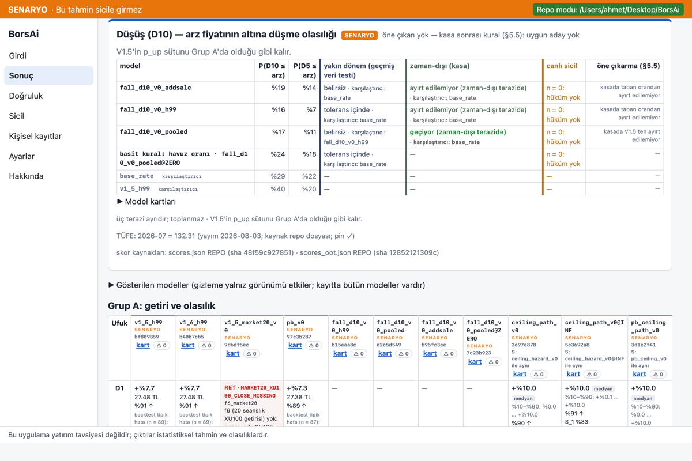
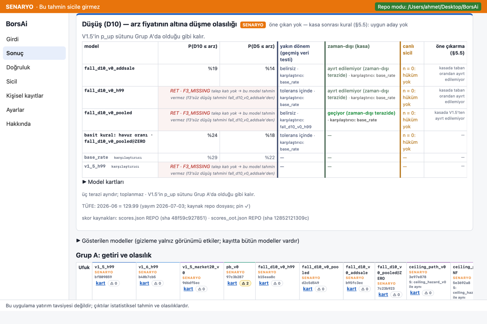
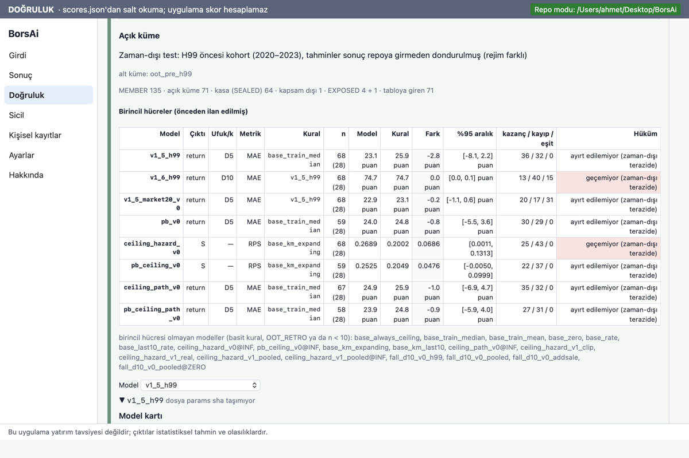
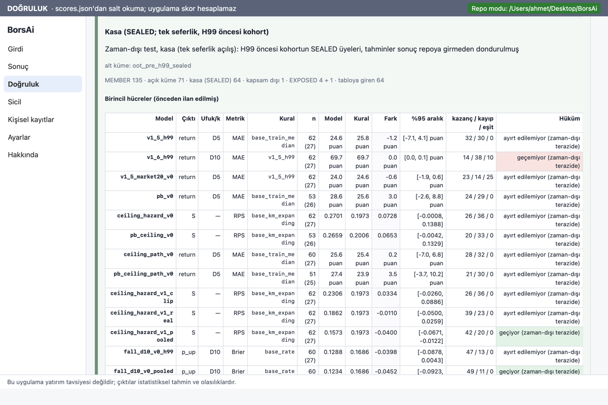
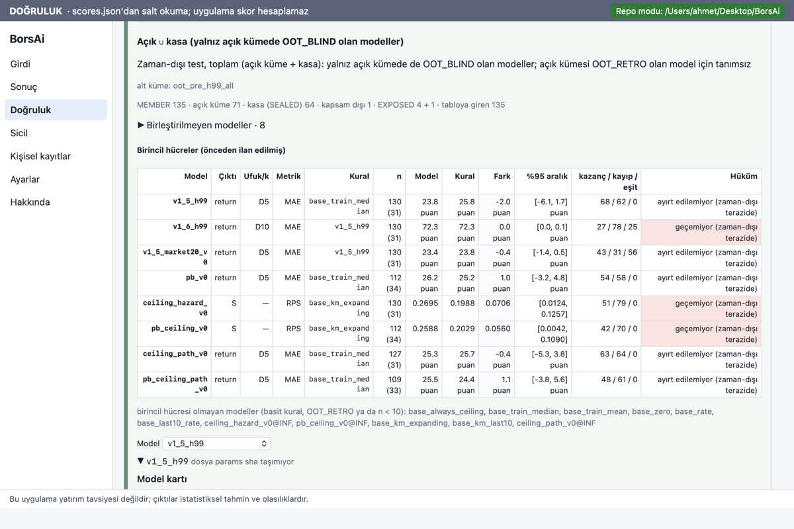
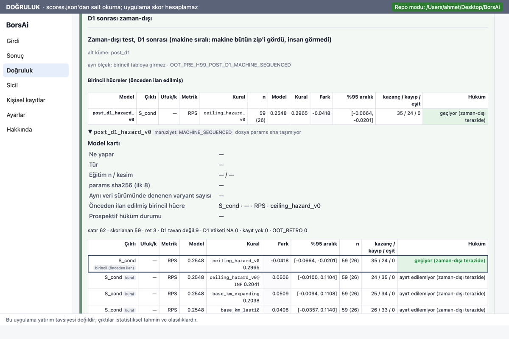

# BORSAI_FAZ7_APP_P3P4 — Rapor (EK 3 Aşama P4: "Düşüş (D10)" kartı, Aşama P3: zaman-dışı panel)

Görev: `docs/prompts/FAZ7_APP_P3P4.md` (TASK_ID BORSAI_FAZ7_APP_P3P4_20261001). Şartname: `docs/app/SPEC_APP_EK3.md` §7, §8, §9
(P3/P4), §10.3, §10.4, §11 (Fable, `7be8394`). Uygulayıcı: Opus 5.5, 2026-10-01. Yalnız `app/`, `docs/app/p34/`, görev dosyası
ve K-P34-5 kapsamında `tests/` pin satırları yazıldı; Python, `models/`, `registry/`, `data/`, `scores/` salt okunur kaldı. Push yok.

Kullanıcı sorusu: **"düşer mi?"** — Sonuç sayfasında "Düşüş (D10) — arz fiyatının altına düşme olasılığı" kartı.

## 0. Özet

1. **P4 port (C1–C3):** `fall_d10_v0` ailesi Rust'ta (`Kind::Fall`, `params::parse_fall`, `fall::predict_fall`,
   `additional_sale_flag`, `ADDITIONAL_SALE_MISSING`). Referans kilidi 11 fark buldu (§2); kod Python'u izler. Altın vektörler
   27 model: dört (C) dosyası **635/635 satır bit-eşit** (maks |Δ| 0), yamalı 51 → 61. Eski 23 altın dosya, üç koşullu dosya
   ve `post_d1_hazard_v0.jsonl` P2 tabanıyla (`0041dc9`) **bayt-eşit**. `PINNED_MODEL_IDS` 27, **`ignored_model_ids == []`**.
2. **K-P4-3 (gerçek kayıt paritesi):** eski kohort açık küme kayıtları (71 üye, ikinci kayıt) — **284 hücre, parite 284/284**,
   bit-eşit 284, durum dağılımı önceden yazılı tabloyla birebir. Kasa (SEALED) dizinleri açılmadı.
3. **P4 kart (C4):** gerçek dosyalarla **öne çıkan yok — kasa sonrası kural (§5.5): uygun aday yok**; `pooled` satırında
   "kasada V1.5'ten ayırt edilemiyor", `h99` ve `addsale` satırlarında "kasada taban orandan ayırt edilemiyor"; kasa sütunu
   `pooled` "geçiyor (zaman-dışı terazide)", `h99`/`addsale` "ayırt edilemiyor (zaman-dışı terazide)", karşılaştırıcı `base_rate`;
   yakın dönem etiketleri ve karşılaştırıcıları dosyadan. 1 − p_up ve %k / %(100 − k) Rust'ta; ön uçta hesap yok.
4. **P3 panel (E1–E2):** Doğruluk sekmesinde üçüncü bağımsız bölüm `.panel-oot`; açık küme 27 model / 8 birincil, kasa 27 / 14,
   toplam 19 / 8, D1 sonrası üç alt bölüm; birincil hücreler `SCORES_OOT.md` §2/§6/§8.1/§9.1/§10/§11 ile birebir (vitest
   karşılaştırması). Satır tablosu **yalnız açık küme bloğunda ve yalnız `open == true`**; kasa kodu DOM'da, fikstürlerde ve
   ekran görüntülerinde yok (yalnız sayıyla sınandı).
5. **Son kabul:** sıralı pytest **866 geçti**, `test.sh` yeşil (cargo 151, vitest 305/305, parity 8, golden_unchanged),
   `gen_golden --check` 35/0. `.app` derlendi (§9); sha256 `4a51f11f…`.

## 1. Commit'ler

| Adım | Commit | İçerik |
|---|---|---|
| C1 | `46039fb` | crate: `Kind::Fall` (`algorithm` ile), `parse_fall` (Python `_check_params` sırası), `fall.rs` (`predict_fall`, `additional_sale_flag`), `output::FallOut` (`LinearOutput.fall`), `ADDITIONAL_SALE_MISSING`; referans kilidi `app/parity/README.md` (U76); `tr.ts` `CODE_TEXT`/`KIND_TEXT`; `tests/fall_semantics.rs`; görev dosyası |
| C2 | `2a29dd4` | `gen_golden.py` 27 model (`FALL_IDS`, 11 kaynak), dört (C) dosyası (635 satır), `_patched_params.jsonl` +10, MANIFEST, `bit_equal_floor.json` 27; `golden.rs fall_parity` (U77), `coverage.rs fall_coverage` (U78), `golden_unchanged.sh` taban `0041dc9` (U80), `test_gen_golden.py` |
| APPPIN | `3ab9d1e` | `tests/test_faz7c_model.py::test_app_golden_pins_unchanged`: `gen_golden --check` 31 → 35 dosya; `predict_fall.py` artık uygulama MANIFEST'inde (yalnız pin satırları; K-P34-5) |
| C3 | `41f14f0` | `build_embed.rs` PINNED 27, `ignored_model_ids == []`; `predict_all` 27 sütun; `deflator_pins` Python `freeze.deflator_pins` anlamında (4 pin); uygulama paritesinde `add_sale_used`; `records_parity fall_oot_open` (K-P4-3); kayıt paritesi 16/16 + 11 / 27/27; UI fikstürleri |
| C4 | `dfd5dfe` | `scores::featured_fall`, `commands/fall.rs` (`FallSummary`, `CeilingSummary.fall`), `render/summary.ts renderFallSummary`, `tr.ts`; U79 ve gerçek dosya testleri (Rust + vitest) |
| E1 | `6b783b9` | `commands/scores_oot.rs`: açık küme satırları (yalnız `open == true`, özet), RETRO süzgeci, `scores_oot_view` / `scores_oot_model`; `tests/oot_panel.rs` (U73, U74, U75 Rust) |
| E2 | `d7868d6` | `render/accuracy_oot.ts` (`.panel-oot`), `accuracy.ts` üç terazi notu, ekran, tipler, `tr.ts` `ACCURACY.oot` + `VERDICT_OOT_SUFFIX`, `styles.css`; `tests/accuracy_oot.test.ts` (U71–U75) |
| E2 (ek) | `9ddcab6` | zaman-dışı model bloğunda model kartı (`CardVM`), D1 sonrası alt bölüm başlığı tek, iki küçük metin düzeltmesi; yalnız geliştirmede çalışan P3/P4 görüntü adımları (`VITE_BORSAI_DEMO_P34`, `scripts/screens_p34.sh`) |
| R | (bu commit) | `docs/app/p34/RAPOR.md`, `test_runs.txt`, `ekran/*.png` |

Taban: `572ac1f` (= origin/main). Ağaçta yalnız izinli görev dosyası vardı.

Önemli sha'lar:
- `models/INDEX.json` `7e636e8bf64b25d79bac04f4bf78b9f870cded8d4d1c10009b6926941e4edb59` (27 giriş; değişmedi).
- `borsai/predict_fall.py` `6e9aa3f03341eecd70eba9dec43559b419f2f97303e4bc2f7f2304eb3631370a` (MANIFEST `predict_sources_sha256`).
- Altın dosyalar: `fall_d10_v0_h99.jsonl` `781fb427…`, `_pooled` `ddf107e8…`, `_addsale` `1c8d4dd3…`, `_pooled@ZERO` `3f729aaf…`;
  `_patched_params.jsonl` `280306f0…`; `MANIFEST.json` `6eb5e9a6…` (`n_cases` 938).
- `scores/scores.json` sha12 `48f59c927851`; `scores/scores_oot.json` sha12 `12852121309c` (üretim 2026-09-29T18:08:37Z, kod `38d36e812877`).

## 2. Referans kilidi farkları (U76; `app/parity/README.md` "Faz 7C düşen arz ailesi: referans kilidi")

EK 3 §8 Python referansı yokken yazılmıştı; çelişkide Python kazandı, EK 3 değiştirilmedi.

| # | Konu | EK 3 §8 | Python (Rust bunu izler) |
|---|---|---|---|
| 1 | Tür ayrımı | `family == "fall_d10_v0"` → Fall | `freeze.model_kind`: `algorithm == "l2_logit_v1_6_grid"` → `"fall"`; `family` silinmiş dosya da `fall` türünde ve `PARAMS_INVALID` (EK 3: "Linear'a düşer") |
| 2 | Ret sırası | compute_features → F3 → add_sale → TÜFE | compute_features (yalnız f3'lü modelde) → `F3_MISSING` → `F3_FILTER_STATUS_CONFLICT` → TÜFE → ek satış; ek satış reddinde `f1r_raw`/`tufe_index_used` dolu kalır |
| 3 | `F3_MISSING` | V1.5 politikası | f3 boşsa politikaya bakmadan ret |
| 4 | Kırpma kodu | `F3_WINSORIZED` ya da `FEATURE_CLIPPED…` | `FEATURE_CLIPPED_TO_TRAINING_P05_P95` (f1r ve f3) |
| 5 | Çıktı anahtarları | `{model_id, D10, D5, warnings, refused}` | `{model_id, D5, D10, warnings, refused, clipped, clipped_features, f1r_raw, tufe_index_used, add_sale_used}`; ufuk sırası D5, D10 |
| 6 | `direction` | `p ≥ 0.5 → UP` | `UP` ancak `p > 0.5` |
| 7 | `@ZERO` | `variant` "pooled" | `variant "pooled@ZERO"`, `features []`, `preprocessing null`, `deflator` yok, iki `constant` başlık; hiçbir girdi okunmaz, ret yok |
| 8 | `addsale` | — | yalnız `additional_sale_shares` okunur (fiyat/pay/f3/TÜFE gerekmez) |
| 9 | Sabit değer | V1.5 (bool = 1.0) | `bool` → `PARAMS_INVALID` |
| 10 | Denetim | `parse_linear` kalıbı | ufuklar tam `{D5, D10}`, `return` null, özellik listesi üç biçimden biri, ön işleme kolonları ⊆ özellikler |
| 11 | Ek satış ayrıştırma | yok/null/""/DATA_NOT_FOUND | `parse_decimal(required=False)`: boşluk da eksik; bool/`inf`/`nan`/sayı değil `INPUT_NOT_NUMERIC`; `-0` → 0 |

EK 3 §11'in "en olası farklar" tahmini (tür adı, kırpma kodu, `@ZERO` biçimi, `direction`) dördü de gerçekleşti; ek olarak sıra ve
çıktı anahtarları farklıydı.

## 3. U71–U80 ve K-P4-3; EK 3 §11 ve görev dosyası beklentileriyle karşılaştırma

| # | Test (yöntem) | Sonuç | Beklenti · fark |
|---|---|---|---|
| U71 | Üç terazi ayrı (vitest `accuracy_oot.test.ts`) | `.panel-backtest`, `.panel-live`, `.panel-oot` ayrı, hiçbir öğe ikisini taşımıyor; `.panel-oot` model bloğunun dışında; `data-scale="oot"` satırları yalnız panelde; `scalesNote` üç teraziyi sayıyor; statik tarama (`accuracy_oot.ts` backtest/canlı listesi okumuyor, birleştirme yok) | Tuttu. |
| U72 | Hüküm eki ve renk (sentetik n = 35) | "geçiyor/geçemiyor/ayırt edilemiyor (zaman-dışı terazide)", renk yalnız ilk ikisinde; `by_year` n = 26 "yetersiz örnek" (ek ve renk yok), n = 1 "metrik yok (n < 10)"; `VERDICT_OOT_SUFFIX` "geçiyor" içermiyor; U19 kaynak taraması geçti | Tuttu. |
| U73 | Fail-closed ve hijyen (vitest + `cargo test --test oot_panel`) | `n_scored = 8` iken hücre → `OOT_CELLS_BELOW_MIN_N`; `geçiyor` + n = 20 → `VERDICT_WITHOUT_INTERVAL`; `n_live = 1` → `OOT_LIVE_COUNTS_NONZERO`; açık küme bloğunda `open: false` satır → `OOT_ROW_NOT_OPEN`, metin "1 satır açık küme değil", satırın kodu DOM'da yok; RETRO'da açık satırda geçmeyen kod çizilmiyor (sayı var); sürüm 2 → sürüm mesajı; dosya yok / repo modu yok metinleri | Tuttu. |
| U74 | Kasa alt bölümleri (sentetik) | kasa ve toplam ayrı bölüm, her blok kendi `subset` etiketiyle, toplam satırı yok, "kasa: açıldı — {generated_at_utc}"; kasa bloğu yokken "kasa: kapalı — …" | Tuttu. |
| U75 | Gerçek dosya (vitest + Rust; K-P3-3) | blok/model/birincil: açık küme **27 / 8**, kasa **27 / 14**, toplam **19 / 8**, D1 sonrası **3 alt bölüm (1'er)**; birincil hücreler `SCORES_OOT.md` §2, §8.1, §9.1, §6, §10, §11 ile n (blok), model, karşılaştırılan, fark, aralık (4 ondalık), k/k/e ve hüküm birebir; `post_d1` birincil "geçiyor (zaman-dışı terazide)" n = 59; DOM'da 71 açık kod, kasa kodu 0; RETRO 568 çift, çizilmeyen 0; kasa satırı "kasa: açıldı — 2026-09-29T18:08:37Z" | K-P3-3 beklentisi birebir. EK 3 §11'in "19 blok" beklentisi eskiydi (görev bağlamı 6). |
| U76 | Referans kilidi | §2: 11 fark, `app/parity/README.md` | Tuttu. |
| U77 | Parite 27/27 (`--test golden`) | **27/27**; dört (C) dosyası **635 satır, 635 bit-eşit**, maks \|Δ\| 0; `direction`, `add_sale_used` birebir; `return*`/`price` null ↔ null; yamalı 61/61 ((C) 10: PARAMS_INVALID 7, SCHEMA_UNSUPPORTED 1, F3_FILTER_STATUS_CONFLICT 1, tahmin 1); `bit_equal_floor` 27 taban (C için 635) | Beklenti ≥ 560 satır, p_up ≤ 1e-9 (bit-eşit) → tuttu. |
| U78 | Kapsama (`--test coverage fall_coverage`) | `ADDITIONAL_SALE_MISSING` h99/pooled 9 (yok 1, null 5, boş 2, DATA_NOT_FOUND 1), addsale 20; `INPUT_NEGATIVE` (`additional_sale_shares`) 2'şer; `add_sale = 1` h99 25, pooled 25, addsale 31; `F3_MISSING` ve `TUFE_*` yalnız h99/pooled (her TÜFE kodu ≥ 2); kırpma h99 f1r 24/17, f3 14/26, pooled f1r 12/15, f3 14/11 (alt/üst); `@ZERO` 635/635 satır sabit başlıklarla bit-eşit | Tuttu (eşikler: ≥ 6, ≥ 2, ≥ 20, ≥ 200). |
| U79 | Düşüş kartı (vitest `summary.test.ts` + `stage2 featured_fall_rules`, `fall_summary_fixtures`) | sentetik: kasa yok → öne çıkan yok "kasa: bekliyor"; uygun iki aday → düşük Brier (h99); yuvarlanınca eşit → basit olan (addsale); k3 (h99/addsale aralığı 0'ın üstünde; pooled "bozuyor"); yakın dönem bloğu yok → uygun yok; k2 `ci95[1] = 0.0` → uygun değil; gerçek dosyalar: öne çıkan yok, `first_failed` addsale k1, h99 k1, pooled k2; satır sırası addsale, h99, pooled, @ZERO, base_rate, v1_5_h99; büyük satır ve %k + %(100 − k) = 100; RET metinleri; statik: `featured_fall` istatistik/toplama çağırmıyor | Tuttu; EK 3'ün "kasada geçen aday yok" metni K-P4-1 gereği kullanılmadı (§8-1). |
| U80 | U46/U55 genişlemesi (`golden_unchanged.sh`, e2e) | 23 eski model + 3 koşullu + `post_d1_hazard_v0` altın dosyası `0041dc9` ile bayt-eşit; `_patched_params.jsonl` ilk 19/31/43/51 satır; `dec_cases.json` eski bölümler; `ignored_model_ids == []`; geçici klonda yeni kayıt 27 model, **parite 27/27** \|Δ\|max 0; eski 7 kayıt "16/16 + kayıtta yok: 11" | Tuttu ("taban P2 commit'i" = altın dosyaların P2'deki son commit'i `0041dc9`; 572ac1f ile içerik aynı). |
| K-P4-3 | Gerçek kayıt paritesi (`BORSAI_REPO=… cargo test -p borsai_predict --test records_parity fall_oot_open -- --ignored`) | açık üye 71, (C)'li kayıt 71, **hücre 284, parite 284/284**, bit-eşit 284, maks \|Δ\| 0; addsale 70 PREDICTED + 1 `ADDITIONAL_SALE_MISSING`; h99 ve pooled 67 PREDICTED + 1 `ADDITIONAL_SALE_MISSING` + 3 `F3_MISSING`; @ZERO 71 PREDICTED | Önceden yazılı beklentiyle **birebir**. |

EK 3 §11 P4'ün diğer satırları: NETGL (`additional_sale_shares "0"`) → `add_sale_used 0`, `tufe_index_used "132.31"`, `clipped false`; VEYAS →
h99/pooled `F3_MISSING`, addsale ve @ZERO tahmin (U63 güncellemesi: **10 RET + 17 dolu**). Test sayısı artışı P3+P4: cargo +17
(134 → 151), vitest +33 (272 → 305), parity +1 (7 → 8); EK 3'ün dört aşamalık tahmini (cargo ≈ +30, vitest ≈ +45, parity ≈ +6)
P1–P4 toplamında aşıldı (cargo 94 → 151, vitest 222 → 305, parity 4 → 8).

## 4. Gerçek dosyalarla "Düşüş (D10)" kartı (metin)

Kaynaklar: `scores/scores.json` (sha12 `48f59c927851`), `scores/scores_oot.json` (sha12 `12852121309c`), gömülü INDEX (27 model).
Fikstür: `app/tests/fixtures/ui/summary_fall_real_netgl.json` (NETGL girdileri, T = 2026-09-17). Ekran: `ekran/p34_01…`.

- **Başlık:** "Düşüş (D10) — arz fiyatının altına düşme olasılığı" · SENARYO · **öne çıkan yok — kasa sonrası kural (§5.5): uygun aday yok**
- Büyük satır yok (öne çıkan yok); "V1.5'in p_up sütunu Grup A'da olduğu gibi kalır."
- **§5.5 denetimi (dosyadaki alanlar):**

| Aday | k1: kasa birincil (D10 Brier − base_rate) | k2: V1.5'e karşı üst uç < 0 | k3: yakın dönem | İlk sağlanmayan |
|---|---|---|---|---|
| addsale | ayırt edilemiyor (model 0.1601) ✗ | +0.0780 ✗ | − base_rate alt uç −0.0301 (0'ın üstünde değil) ✓ | k1 |
| h99 | ayırt edilemiyor (0.1288) ✗ | +0.0302 ✗ | − base_rate alt uç −0.0773 ✓ | k1 |
| pooled | geçiyor (0.1234) ✓ | +0.0320 ✗ | "belirsiz" (bozuyor değil) ✓ | k2 |

- **Tablo** (P(D10 ≤ arz) · P(D5 ≤ arz) | yakın dönem · karşılaştırıcı | zaman-dışı (kasa) · karşılaştırıcı | canlı | öne çıkarma (§5.5)):

| Rol | Model | D10 · D5 | Yakın dönem | Zaman-dışı (kasa) | Canlı | §5.5 |
|---|---|---|---|---|---|---|
| aday | fall_d10_v0_addsale | %19 · %14 | belirsiz · base_rate | ayırt edilemiyor (zaman-dışı terazide) · base_rate | n = 0: hüküm yok | kasada taban orandan ayırt edilemiyor |
| aday | fall_d10_v0_h99 | %16 · %7 | tolerans içinde · base_rate | ayırt edilemiyor (zaman-dışı terazide) · base_rate | n = 0: hüküm yok | kasada taban orandan ayırt edilemiyor |
| aday | fall_d10_v0_pooled | %17 · %11 | belirsiz · fall_d10_v0_h99 | **geçiyor (zaman-dışı terazide)** · base_rate | n = 0: hüküm yok | kasada V1.5'ten ayırt edilemiyor |
| basit kural: havuz oranı | fall_d10_v0_pooled@ZERO | %24 · %18 | tolerans içinde · base_rate | — (birincil hücre yok) | n = 0: hüküm yok | — |
| karşılaştırıcı | base_rate | %29 · %22 | — | — | — | — |
| karşılaştırıcı | v1_5_h99 | %40 · %20 | — | — | — | — |

- Ham değerler tooltip'te (ör. h99 D10 p_up = 0.8371493107629145, 1 − p_up = 0.16285068923708547).
- Alt satırlar: "üç terazi ayrıdır; toplanmaz · V1.5'in p_up sütunu Grup A'da olduğu gibi kalır."; "TÜFE: 2026-07 = 132.31 (yayım
  2026-08-03; kaynak repo dosyası; pin ✓)"; skor kaynakları; katlı "Model kartları" (h99: eğitim n 94, kesim 2026-08-19, sha `b15eaa8c`,
  varyant 23; pooled 161 / `d2c5d549` / 2059; addsale 165 / `b95fc3ec` / 2059; @ZERO 161 / `7c23b923` / 2059; birincil hücre "D10 Brier − taban oran").
- **VEYAS (f3 boş):** h99 ve pooled "RET · F3_MISSING — talep katı yok → bu model tahmin vermez (f3'süz düşüş tahmini
  fall_d10_v0_addsale'den)"; addsale %19 · %14, @ZERO %24 · %18; V1.5 karşılaştırıcısı da F3_MISSING; terazi sütunları aynı.
- **Arz sayfası (NETGL, 16 modelli resmi kayıt):** RESMİ KAYIT · "kaynak: kayıt 20260922T121936Z_65a39d7392dd.json"; dört (C)
  satırı "kayıt bu modeli içermiyor (kayıt INDEX'ten eski)" (listeden kalkmaz), karşılaştırıcılar kayıttan.

## 5. Gerçek dosyalarla zaman-dışı panel (metin)

Kaynak: repo dosyası · üretim 2026-09-29T18:08:37Z · kod `38d36e812877` · kohort `7d05b334d739` · dosya sha `12852121309c`.
Başlık (dosyadan): "Zaman-dışı test: H99 öncesi kohort (2020–2023), tahminler sonuç repoya girmeden dondurulmuş (rejim farklı)".
**kasa: açıldı — 2026-09-29T18:08:37Z**. Not: "Üç terazi bağımsızdır: geçmiş veri testi (retrospektif, tasarıma maruz), zaman-dışı test
(eski kohort) ve canlı sicil (prospektif) hiçbir yerde toplanmaz, ortalanmaz, tek hükümde birleşmez."

- **Açık küme** — MEMBER 135 · açık küme 71 · kasa (SEALED) 64 · kapsam dışı 1 · EXPOSED 4 + 1 · tabloya giren 71. Birincil hücreler (8):

| Model | Hücre | Karşılaştırılan | n (blok) | fark | %95 aralık | hüküm |
|---|---|---|---|---|---|---|
| v1_5_h99 | return D5 MAE | base_train_median | 68 (28) | −0.0282 | [−0.0807, +0.0225] | ayırt edilemiyor (zaman-dışı terazide) |
| v1_6_h99 | return D10 MAE | v1_5_h99 | 68 (28) | +0.0004 | [+0.0003, +0.0006] | geçemiyor (zaman-dışı terazide) |
| v1_5_market20_v0 | return D5 MAE | v1_5_h99 | 68 (28) | −0.0018 | [−0.0112, +0.0059] | ayırt edilemiyor (zaman-dışı terazide) |
| pb_v0 | return D5 MAE | base_train_median | 59 (28) | −0.0082 | [−0.0550, +0.0358] | ayırt edilemiyor (zaman-dışı terazide) |
| ceiling_hazard_v0 | S RPS | base_km_expanding | 68 (28) | +0.0686 | [+0.0011, +0.1313] | geçemiyor (zaman-dışı terazide) |
| pb_ceiling_v0 | S RPS | base_km_expanding | 59 (28) | +0.0476 | [−0.0050, +0.0999] | ayırt edilemiyor (zaman-dışı terazide) |
| ceiling_path_v0 | return D5 MAE | base_train_median | 67 (28) | −0.0101 | [−0.0688, +0.0466] | ayırt edilemiyor (zaman-dışı terazide) |
| pb_ceiling_path_v0 | return D5 MAE | base_train_median | 58 (28) | −0.0089 | [−0.0590, +0.0396] | ayırt edilemiyor (zaman-dışı terazide) |

  Birincil hücresi olmayan 19 model (basit kurallar ve OOT_RETRO v1/(C)). Ekranda MAE'ler "puan" birimiyle (−2.8 puan = −0.0282).
  Model bloğu (seçici): kart, sayaçlar ("skorlanan 68 · ret 3 · …"), bütün hücreler, katlı kırılımlar (`by_year`, `by_regime`),
  katlı **satır tablosu 71 açık satır** (arz · D1 · yıl · rejim · sınıf · durum · tahmin · gerçekleşen · kayıt).
- **Kasa (SEALED; tek seferlik)** — tabloya giren 64; birincil hücreler 14 (§8.1 ile aynı): `ceiling_hazard_v1_pooled` (−0.0400
  [−0.0671, −0.0122]) ve `fall_d10_v0_pooled` (−0.0452 [−0.0923, −0.0020]) "geçiyor (zaman-dışı terazide)"; `v1_6_h99` "geçemiyor";
  kalan 11 "ayırt edilemiyor". Satır tablosu ve kod yok.
- **Açık ∪ kasa** — tabloya giren 135; birincil 8 (§9.1 ile aynı; `ceiling_hazard_v0` +0.0706 [+0.0124, +0.1257] ve `pb_ceiling_v0`
  "geçemiyor", `v1_6_h99` "geçemiyor", kalan 5 "ayırt edilemiyor"); birleştirilmeyen 8 model (v1 dördü, (C) dördü; neden metni dosyadan).
- **D1 sonrası zaman-dışı** (ayrı ölçek `OOT_PRE_H99_POST_D1_MACHINE_SEQUENCED`, maruziyet MACHINE_SEQUENCED): açık küme S_cond RPS −
  ceiling_hazard_v0 n = 59 (26) −0.0418 [−0.0664, −0.0201] **geçiyor (zaman-dışı terazide)**; kasa n = 45 (25) −0.0347 [−0.0715,
  +0.0044] ayırt edilemiyor; toplam n = 104 (30) −0.0387 [−0.0604, −0.0173] geçiyor. Satır tablosu ve kod yok.
- **OOT_RETRO (yalnız bilgi)** — 568 çift (8 model × 71), hepsi açık satırda geçen kodlarla; çizilmeyen 0.

## 6. Ekran görüntüleri (`docs/app/p34/ekran/`)

Koşu: `bash app/scripts/screens_p34.sh` (`VITE_BORSAI_DEMO=1 VITE_BORSAI_DEMO_P34=1 npm run tauri dev -- --features snapshot`;
uygulama verisi geçici dizinde). Asıl repo salt okunur: `registry/` ve `data/` sha listesi öncesiyle aynı. Kasa kodu görünmez
(panel yalnız açık küme kodlarını gösterir; vitest ve Rust taramaları 0 ölçtü).

| Dosya | İçerik |
|---|---|
| `p34_01_netgl_dusus_karti.png` | NETGL: düşüş kartı (öne çıkan yok, §5.5 sütunu, üç terazi sütunu, TÜFE) ve altında Grup A |
| `p34_02_netgl_dusus_tablo_kartlar.png` | NETGL: kart tablosu ve açılmış model kartları |
| `p34_03_netgl_kartlar_ust_uste.png` | NETGL: tavan serisi kartı ve hemen altında düşüş kartı |
| `p34_04_veyas_dusus_karti.png` | VEYAS: h99/pooled `RET · F3_MISSING`, addsale ve @ZERO tahmin |
| `p34_05_arz_sayfasi_netgl_dusus.png` | NETGL arz sayfası (16 modelli kayıt): (C) satırları "kayıt bu modeli içermiyor" |
| `p34_06_zaman_disi_baslik.png` | Doğruluk: zaman-dışı panelin başı (kaynak, kasa satırı, üç terazi notu) |
| `p34_07_zaman_disi_acik_kume.png` | Açık küme: kohort sayaçları, 8 birincil hücre |
| `p34_08_zaman_disi_acik_kume_hucreler.png` | Açık küme model bloğu: kart, sayaçlar, hücreler |
| `p34_09_zaman_disi_acik_kume_satirlar.png` | Açık küme satır tablosu (yalnız açık kodlar) |
| `p34_10_zaman_disi_kasa.png` | Kasa: 14 birincil hücre |
| `p34_11_zaman_disi_kasa_dusus_pooled.png` | Kasa, `fall_d10_v0_pooled` model bloğu (hücreler, kırılımlar; satır yok) |
| `p34_12_zaman_disi_toplam.png` | Açık ∪ kasa |
| `p34_13_zaman_disi_d1_sonrasi.png` | D1 sonrası zaman-dışı (üç alt bölüm) |
| `p34_14_zaman_disi_retro.png` | OOT_RETRO (568 çift; açık kodlar) |








## 7. Test sayıları

| Koşu | Taban (`572ac1f`) | Son (`9ddcab6` + rapor) |
|---|---|---|
| `bash app/scripts/test.sh` | cargo 134 · vitest 272 (19 dosya) · parity 7 · golden_unchanged yeşil | **cargo 151 · vitest 305 (20 dosya) · parity 8 · golden_unchanged yeşil** |
| `gen_golden --check` | 31/0 | **35/0** |
| pytest | paralel 866 geçti (15 dk 10 sn) | **sıralı 866 geçti** (16 dk 38 sn) |
| e2e | — | `e2e_freeze_tmp_repo.sh` yeşil (U80: 27/27) |

Kırılıp yeniden pinlenen satırlar (K-P34-5; mantık değişmedi): Python `tests/test_faz7c_model.py` 31 → 35 ve `predict_fall.py`
MANIFEST'te (APPPIN `3ab9d1e`); `app/parity/test_gen_golden.py` (27 model, 11 kaynak, yamalı 61, post_d1 yamalı dilimi 43:51);
Rust `build_embed.rs` (27, `ignored == []`), `integrity.rs` (27; VEYAS 10 RET; T yokken dört deflatörlü TUFE_MISSING), `stage2.rs`
(U63 10 + 17, senaryo 27, kart 27), `stage3.rs` (16/16 + 11; 27/27; dört TÜFE pini), `e2e.rs` (27/27; 11), `golden.rs` (27);
vitest `results.test.ts` (27 sütun; 10 RET + 17; filigran 30), `freeze.test.ts` (27), `scenario.test.ts` (27); UI fikstürleri
Rust'ın gerçek çıktısından (`BORSAI_UPDATE_UI_FIXTURES=1`; yalnız zaman damgası değişen `score_hints.json` geri alındı).
Ayrıntı `test_runs.txt`.

## 8. Sapmalar, kararlar, dosya listesi dışı dokunuşlar

1. **K-P4-1 metni SPEC_C §9'dan sapar:** uygun aday yokken kart "öne çıkan yok — kasa sonrası kural (§5.5): uygun aday yok" yazar;
   SPEC_C §9 / EK 3 §8.4'ün "kasada geçen aday yok" metni kullanılmadı (pooled kasada k1'i geçti; o metin yanıltırdı). Kasa
   kapalıyken "öne çıkan yok — kasa: bekliyor".
2. **k3 kaynağı:** EK 3 §8.4-5 h99/addsale için `backtest.cells` hücresini söyler; K-P4-1 gereği `scores.json` `near_era` bloğu
   okunur (karşılaştırıcı `base_rate` olmalı; `ci95[0] > 0` → k3 sağlanmaz). pooled için etiket "bozuyor" değil. Blok yoksa, sürüm
   desteklenmiyorsa ya da karşılaştırıcı beklenen değilse k3 = false (fail-closed). Eşitlik: `round(model_value, 3)`, sonra
   addsale < h99 < pooled (EK 3 §8.4; SPEC_C sözde kodu).
3. **Yakın dönem sütunu:** EK 3 §8.4-3'ün "yalnız pooled'da etiket" önerisi yerine K-P4-2: dört (C) modelinde de dosyadaki etiket +
   karşılaştırıcı.
4. **Karşılaştırıcı satırları** (`base_rate`, `v1_5_h99`): yalnız P(D10/D5 ≤ arz) (Grup A'daki p_up'tan, 1 − p_up Rust'ta);
   terazi sütunları "—" (o modellerin birincil hücreleri başka büyüklükleri ölçer; tooltip açıklar).
5. **Kart arz sayfasında da var** (EK 3 §8.4 Sonuç sayfası der; SPEC_C §9 "sicil ve senaryo ekranlarında" der): resmi görünümde değerler
   yalnız kaydın hücrelerinden (U62 kalıbı; `stage3 official_fall_summary_uses_record_only`). Bugünkü 7 canlı kayıt 16 modelli olduğundan
   (C) satırları "kayıt bu modeli içermiyor".
6. **Kartın yeri ve yapısı:** `CeilingSummary.fall` (`commands/fall.rs` yeni; komut katmanı doldurur). Ayrı Tauri komutu yok; tavan
   serisi kartıyla aynı çağrı.
7. **`KIND_TEXT.fall`** EK 3 §9 metnine çekildi: "düşen arz (D5/D10 arz altı kapanış olasılığı)" (APPPIN_S2 notu: "EK 3 P4 kesinleştirir").
   `INPUT_NEGATIVE` metni `additional_sale_shares` alanında "ek satış payı negatif olamaz".
8. **`deflator_pins`** Python `freeze.deflator_pins` anlamına çekildi (JSON'da `deflator` sözlüğü olan her model): Ayarlar/Hakkında TÜFE
   satırında artık 4 pin (v1 real/pooled, (C) h99/pooled; hepsi aynı önek).
9. **Zaman-dışı panel:** her blokta SCORES_OOT.md kalıbında "Birincil hücreler" tablosu + model seçici (EK 3 §7.2-3 yalnız model
   bloklarını sayar; U75 karşılaştırması bu tabloyla doğrudan). Açılışta her blokta birincil hücresi olan ilk model seçilir (açık
   kümede `v1_5_h99`). Satır özeti Rust'ta (S_1/S_5/S_10 ya da D5 getirisi/p_up; ret kodu; L ve D5 gerçekleşen); `class_evidence`
   tooltip'i beş alanla (dosyada `basis` alanı yok). Hüküm eki EK 3 §7.2 gereği "ayırt edilemiyor"a da eklenir; SCORES_OOT.md yalnız
   "geçiyor"a ekler (biçim farkı). Model-düzeyi `info` (kalibrasyon bilgi satırı) panelde gösterilmiyor.
10. **Dosya listesi dışı `app/` dokunuşları** (asgari tesisat): `commands/{fall.rs (yeni), ceiling.rs, mod.rs}`, `lib.rs` (iki komut),
    `render/format.ts` (`pctInt`), `src/{api,state,types}.ts`, `screens/accuracy.ts`, `styles.css`, `src/dev/demo.ts` ve
    `scripts/screens_p34.sh` (yalnız geliştirme), testler `crates/…/tests/fall_semantics.rs` ve `src-tauri/tests/oot_panel.rs` (yeni).
11. **Test koşu düzeni:** her commit'ten önce `bash app/scripts/test.sh` (cargo + vitest + parity + golden_unchanged); Python tarafı
    APPPIN'den sonra paralel (866) ve sonda sıralı koştu (P2 kalıbı). Python koduna dokunulmadı; app/'e bağlı Python testleri
    (`test_faz7c_model` pini, `app/parity/test_gen_golden.py`) commit'lerinde ayrıca koştu.
12. **Fikstür boyutu:** `scores_oot_panel_real.json` 325 KB (bayt karşılaştırılmaz; yalnız açık küme kodları; Rust testi kasa kodunu 0 sayar).

## 9. Derleme

`source app/scripts/env.sh; cd app; npm run tauri build -- --bundles app` → exit 0 (imza "-", notarizasyon yok).
`app/src-tauri/target/release/bundle/macos/BorsAi.app`; **`BorsAi.app/Contents/MacOS/borsai-app` sha256 `4a51f11f5408a8b4eb5c8551f9ad0694b888a1565e8a16b9303b2b7cc8c64156`** (7 832 416 bayt).
Gömülü HEAD `9ddcab6…`, INDEX `7e636e8b…` (**27 model**, gömülmeyen yok), INDEX_POST_D1 `94ac36fa…`, TÜFE tablosu 2026-08'e kadar,
satırsız `scores_oot` kopyası. `/Applications`'a kopyalanmadı.

## 10. Proje sahibi için kurulum

Önce çalışan uygulamayı kapat (Cmd+Q), sonra:
```
cd ~/Desktop/BorsAi
ditto app/src-tauri/target/release/bundle/macos/BorsAi.app /Applications/BorsAi.app
open /Applications/BorsAi.app
```

## 11. Windows derlemesi için notlar (Mac'e özel kalan yerler)

Yeni P3/P4 kodu platformdan bağımsızdır: yollar `PathBuf::join` / `path.join` ile kurulur, sabit Mac yolu ya da kabuk sözdizimi yok
(K-P34-4). Mac'e özel kalanlar (öncekilerden):
- `app/src-tauri/src/commands/config.rs: default_python` → `<repo>/.venv/bin/python` (Windows: `.venv\Scripts\python.exe`); `tr.ts`
  Ayarlar ipucu aynı yolu yazar.
- `borsai/tufe.py: APPEND_COMMAND` `.venv/bin/python` ile başlar (Ö-P1-1; uygulama repo modunda ayardaki yolu gösterir).
- `commands/freeze.rs` ve `commands/post_d1.rs` komut bloklarında `$(git rev-parse HEAD)` (POSIX kabuk/PowerShell çalışır, `cmd.exe` çalışmaz).
- Bash betikleri: `app/scripts/{test.sh, env.sh, dev.sh, screens.sh, screens_p2.sh, screens_p34.sh}`, `app/tests/{golden_unchanged.sh,
  e2e_*.sh}` (Windows'ta Git Bash ya da PowerShell karşılığı); `env.sh` rustup/nvm'i `~/.cargo` ve `~/.nvm`'den yükler.
- Görüntü düzeneği: `--features snapshot` (objc2 / WKWebView; yalnız macOS) ve betiklerde `sips`.
- `#[cfg(unix)]` testleri (`tufe_source_and_blocker`, D1 sonrası sihirbaz fikstürleri, sahte Python betiği).
- Paketleme `--bundles app` (macOS `.app`); Windows için msi/nsis; kurulum bloğundaki `ditto`/`open` macOS komutlarıdır.
- Vitest kohort okuyucusu satırları `\n` ile böler (repo `.gitattributes` `eol=lf`; Windows'ta da LF kalır).

## 12. Ö-görevleri (Python tarafı; düzeltilmedi)

- **Ö-P1-1 (sürüyor):** `APPEND_COMMAND` ve komut bloklarındaki `.venv/bin/python` / `$(…)` düzeni (§11).
- **Ö-P4-1 (gözlem):** `scores.json` kartında `fall_d10_v0_h99`'un `n_variants_same_data` değeri 23, öteki üç (C) modelinde 2059
  (`n_exploration_family` dördünde 2054). h99 farklı veri sürümüyle (`training_table.csv`) eğitildiği için sayaç aynı-veri kuralıyla
  tutarlı olabilir; uygulama dosyadaki değeri aynen gösterir. Python tarafında teyit edilebilir.
- **Ö-P3-1 (not):** `SCORES_OOT.md` hüküm ekini yalnız "geçiyor"a yazar; EK 3 §7.2 üç hükme de ister. Uygulama EK 3'ü izler; değerler aynı.
- Python'da P3/P4'ü engelleyen eksik bulunmadı; referans kilidi farkları (§2) Python'un tanımıdır, eksik değildir.
